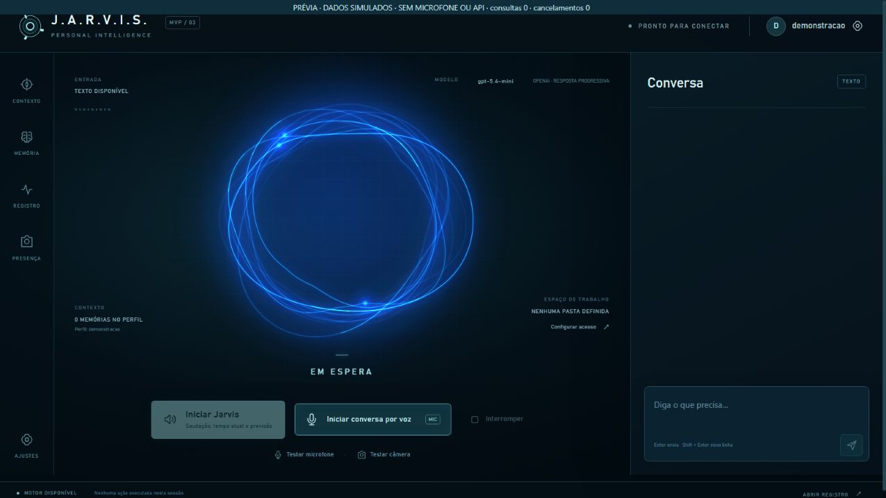

# Projeto GleysonSilva-Jarvis



Prévia visual com dados de demonstração; não representa uma sessão conectada.

Assistente pessoal para Windows com núcleo orbital azul, conversa pela voz configurada e ações locais solicitadas com permissões revisáveis.

**Atualização 0.6.0 — ponte privada com Ultron:** cinco ferramentas MCP para estado, tempo atual, navegador padrão, site solicitado e narração pela voz Jarvis. A conexão começa desligada; habilite em **Ajustes → Conexão privada com Ultron** e salve. Confira **MVP / 06.0**. A direção é **Ultron → Jarvis no computador conectado**: não transfere memórias nem cria uma API para conversar com o Dot pessoal. [CI 2adf71d da 0.6.0](https://github.com/Gleysonp-Dev/GleysonSilva-Jarvis/actions/runs/39852875109) aprovado: **491/491 testes, zero falhas/skips**, TypeScript, build, pacote e abertura nativa do Jarvis com tela cheia. [Windows 0.6.0](https://github.com/Gleysonp-Dev/GleysonSilva-Jarvis/actions/runs/39852875109/artifacts/12459041061) e [plugin privado 0.6.0](https://github.com/Gleysonp-Dev/GleysonSilva-Jarvis/actions/runs/39852875109/artifacts/12458926386) baixados e conferidos; [hashes e instalação](AI_INSTALL.md). O plugin foi instalado e habilitado na máquina de validação; handshake, lista das cinco ferramentas e resposta honesta NOT_RUNNING foram conferidos. A ponte ainda não foi habilitada e não houve chamada real do Ultron. [Guia e limites](docs/ultron.md).

Na conversa normal, um pedido explícito para abrir um site também encaminha o endereço exato ao navegador padrão, sem confirmação extra; domínio sem esquema usa HTTPS. Essa abertura não dá acesso à página ou ao login. [Comandos atuais](docs/desktop-access.md).

As revisões e os pacotes 0.5.3 e anteriores abaixo são históricos e não incluem a ponte 0.6.0.

**Base anterior 0.5.3 — navegador padrão sem confirmação extra:** ao pedir “abra o navegador”, Jarvis encaminha diretamente a abertura da página inicial fixa do Google ao navegador padrão do Windows. Não exige cadastro ou clique em Autorizar. A exceção vale somente para esse pedido; URLs específicas, outros aplicativos, leitura web e alterações em arquivos mantêm suas confirmações. Preserva tela cheia, voz e configurações. Confira **MVP / 05.3**. [CI b856f89 da 0.5.3](https://github.com/Gleysonp-Dev/GleysonSilva-Jarvis/actions/runs/39534111302) aprovado: **415/415 testes, zero falhas/skips**, TypeScript, build, pacote e abertura real do Jarvis, incluindo entrada/saída de tela cheia. Os pacotes anteriores abaixo são históricos. [Comandos e aviso do Firewall](docs/desktop-access.md).

[Pacote Windows 0.5.3](https://github.com/Gleysonp-Dev/GleysonSilva-Jarvis/actions/runs/39534111302/artifacts/12316996601) baixado e conferido. EXE **104.021.514 bytes**, SHA-256 `484ef104c1647ff47ec84c43fbfa085f204faf5b9e9f3025476616e77c019398`. ZIP **104.031.894 bytes**, SHA-256 `1605ed7ba38cdc939e4d7afee52a9c4a0d8bb97564cff47cc5f69a6088399cfb`. Retenção até 18 de janeiro de 2027, horário de Nova York; artefato temporário do GitHub, sem assinatura de release. Feche a versão anterior e abra **GleysonSilva-Jarvis-0.5.3-Windows.exe**; confira **MVP / 05.3**. [Instalação](AI_INSTALL.md).

**Base anterior 0.5.2 — tela cheia:** clique no ícone de expandir, no canto superior direito, ou pressione **F11**. Para voltar à janela, use **Esc**, **F11** ou o mesmo botão. A troca mantém a conversa e as configurações da sessão. Confira **MVP / 05.2**. [CI 4e90ff5 da 0.5.2](https://github.com/Gleysonp-Dev/GleysonSilva-Jarvis/actions/runs/39531815223) aprovado: **413/413 testes, zero falhas/skips**, TypeScript, build, pacote e entrada/saída de tela cheia pelo botão real no aplicativo Windows. Os pacotes anteriores abaixo são históricos. [Uso e validação](docs/fullscreen.md).

[Pacote Windows 0.5.2](https://github.com/Gleysonp-Dev/GleysonSilva-Jarvis/actions/runs/39531815223/artifacts/12315892272) baixado e conferido. EXE **104.021.454 bytes**, SHA-256 `2c991916429b4ddd462a21fd2d277ce8fdb28f3ccd6294829911fef6c545cf49`. ZIP **104.031.845 bytes**, SHA-256 `efcfa48a2dc208301842a09562732da4886dc2553934d764742e1dfa77d3bd4b`. Retenção até 18 de janeiro de 2027, horário de Nova York; artefato temporário do GitHub, sem assinatura de release. Feche a versão anterior e abra **GleysonSilva-Jarvis-0.5.2-Windows.exe**; confira **MVP / 05.2**. [Instalação](AI_INSTALL.md).

**Base anterior 0.5.1:** “abra o navegador” passa a usar o navegador padrão do Windows sem cadastrar executável. Chrome, Edge e Firefox pelo nome usam descoberta dos aplicativos instalados; uma URL informada usa o navegador dedicado. A autorização mostra o nome do aplicativo. O comentário de roupa prepara câmera, análise e voz enquanto a saudação está tocando, mas só reproduz depois que ela termina, sem falas sobrepostas. Se a preparação já estiver pronta, não há espera pelo início das chamadas; rede/serviços ainda podem acrescentar tempo. Voz, música e configurações existentes são preservadas. [CI b8c6c8f da 0.5.1](https://github.com/Gleysonp-Dev/GleysonSilva-Jarvis/actions/runs/39529034939) aprovado: **402/402 testes, zero falhas/skips**, TypeScript, build, pacote e abertura nativa real; [recepção](docs/startup-greeting.md) e [comandos](docs/desktop-access.md).

[Pacote Windows 0.5.1](https://github.com/Gleysonp-Dev/GleysonSilva-Jarvis/actions/runs/39529034939/artifacts/12314447101) baixado e conferido. EXE **104.019.548 bytes**, SHA-256 `ec560e6a0f97d30da134622aa5b9bec512b557d9b335752fb3638eae0c18d3c1`. ZIP **104.029.768 bytes**, SHA-256 `7734d02e37adfd51843f21f25e0e443684b6c3b0664332db44713295b97484f1`. Retenção até 18 de janeiro de 2027, horário de Nova York; artefato GitHub temporário, sem assinatura de release. Feche a versão anterior e abra **GleysonSilva-Jarvis-0.5.1-Windows.exe**; confira **MVP / 05.1**. [Instalação](AI_INSTALL.md).

**Base anterior 0.5.0:** iniciar ao entrar no Windows, aguardar duas palmas, tocar música e saudação com clima, observar uma captura da roupa e continuar ouvindo comandos por voz. A opção de conversa contínua renova o prazo local de conexão sem repetir a recepção. Use **Ajustes → Início e espera → Ativar recepção completa → Salvar configuração**. O botão prepara as opções, incluindo o envio de uma captura à OpenAI e microfone conectado à API após a recepção; nada é ativado antes de salvar. Voz, trilha, chaves e cidade existentes são preservadas. Câmera e continuidade são opcionais e desligadas no pacote público. [CI fced652 da 0.5.0](https://github.com/Gleysonp-Dev/GleysonSilva-Jarvis/actions/runs/39526640376) aprovado: **388/388 testes, zero falhas/skips**, TypeScript, build, pacote e abertura nativa real; [guia da recepção](docs/startup-greeting.md).

Histórico: [Windows 0.5.0](https://github.com/Gleysonp-Dev/GleysonSilva-Jarvis/actions/runs/39526640376/artifacts/12313302731), EXE com SHA-256 `a6fa2f1560ba240a8fef369903a2b6ba3a12cd2f2e879d93e47ce87c402ef9f9`. Essa base não inclui as correções da 0.5.1. Use o pacote atual acima; [tamanhos e histórico](AI_INSTALL.md).

**Base anterior 0.4.0:** descoberta de aplicativos instalados, abertura de pastas locais e consultas explícitas à web e ao tempo atual. As respostas mostram fontes compactas, sem transcrições de voz ou cartões automáticos. Núcleo aprovado, voz, música e Contexto são preservados. O [CI 475f3f4](https://github.com/Gleysonp-Dev/GleysonSilva-Jarvis/actions/runs/39523160110) aprovou **343/343 testes**, zero falhas/skips, TypeScript, build, pacote e abertura nativa real. Veja [Aplicativos, pastas, web e clima](docs/desktop-access.md).

O núcleo é uma implementação original em Canvas: dez curvas de intensidades diferentes formam um contorno assimétrico, com fios ciano, focos luminosos e um campo azul sobre grade plana ampla. O centro continua sem texto e deixa o fundo visível. A paleta ciano/azul permanece fixa em todos os estados; brilho e expansão respondem ao microfone e ao áudio reproduzido. Não contém código ou assets do produto de referência. O desenho respeita movimento reduzido e limita atualização e resolução para controlar o custo de renderização. A [análise do vídeo de referência](docs/research/referencia-video-nucleo.md) distingue o observado da implementação própria.

**Código-fonte:** [Gleysonp-Dev/GleysonSilva-Jarvis](https://github.com/Gleysonp-Dev/GleysonSilva-Jarvis), branch `main`. O [CI da base 0.3.1, commit bfcc67b9](https://github.com/Gleysonp-Dev/GleysonSilva-Jarvis/actions/runs/39519770787), aprovou **264 testes, zero falhas/skips**, TypeScript, compilação, pacote e abertura nativa real em **20 de outubro de 2026, às 20h14, America/New_York**. O usuário aprovou o núcleo da 0.3.1 após a revisão visual. Esse aceite e o CI anterior não validam as novas ferramentas da 0.4.0, a instalação limpa ou todos os dispositivos. Não há release assinada.

Saudação e conversa por voz continuam usando áudio e pulsação, sem falas ou transcrições no painel **Conversa**. Mensagens digitadas e suas respostas permanecem visíveis. A voz aprovada mantém reprodução a **0,95×**, altura preservada e efeito metálico fixo **0,78**. Memórias são preferências explícitas por perfil, revisáveis e apagáveis; não são retreinamento do modelo.

## O que está implementado

| Recurso | Comportamento do código atual |
| --- | --- |
| Ultron → Jarvis local, opcional | Plugin MCP privado com cinco ferramentas: estado, clima atual, navegador padrão, site pedido e narração de até 600 caracteres. Sem envio de microfone ao Dot, migração de memória ou transcrição no painel. Habilitação explícita e teste de disponibilidade na tarefa local são separados da instalação. |
| Recepção completa opcional | Duas palmas → música/saudação → uma captura para comentar roupa visível → comandos por voz. Renovação no prazo local se habilitada; Interromper encerra escuta e renovação. Não repete a recepção ao renovar. |
| Núcleo orbital aprovado | Desenho da 0.3.1 preservado: dez curvas com intensidades distintas e deformação assimétrica, focos ciano e campo azul com grade plana ampla. Paleta fixa e pulso reativo, sem texto central ou telemetria decorativa. |
| Contexto sob demanda | Botão **Contexto** abre clima e atividade local. Abrir/atualizar não liga o microfone, não gera fala e não chama um modelo de linguagem. |
| Clima com origem | Tempo atual e previsão de hoje, horários da observação/consulta, atribuição e indicação de cache. Funciona com cidade configurada, mesmo sem saudação automática ou chave ElevenLabs. |
| Atividade do perfil | Contagem por estado sobre um snapshot de até 100 execuções recentes e lista de até oito. Aberturas enviadas ao Windows sem evidência da janela ficam identificadas separadamente. É registro local, sem eventos de agenda. |
| Aplicativos instalados | Descoberta por nome no inventário Windows e abertura, após confirmação, de um ID observado no perfil. Não aceita comandos livres ou IDs inventados. |
| Pastas locais | Abertura no Explorador de pastas conhecidas ou caminhos absolutos em unidades locais acessíveis, com confirmação. Abrir não concede leitura/organização fora da pasta de trabalho. |
| Página e pesquisa web | Leitura explícita de texto público HTTP(S), sem JavaScript/login/cookies, e pesquisa hospedada OpenAI com a chave/modelo configurados. Ambas exigem confirmação e devolvem fontes; a busca pode consumir a conta. |
| Tempo solicitado agora | `weather_current` consulta a cidade configurada com atualização explícita, sem iniciar saudação, música ou síntese. Falha não usa uma previsão antiga como atual. |
| Fontes compactas | Até seis links, título/domínio e horário, fora do log de mensagens. Sem cartões automáticos ou transcrição da resposta falada; perfil/reset limpa a faixa. |
| Texto com OpenAI | Responses com streaming, histórico limitado e ferramentas. |
| Conversa com a voz Jarvis | Microfone via OpenAI Realtime; respostas em texto são sintetizadas pela ElevenLabs com a voz configurada. A saída de áudio OpenAI é desativada. O novo fluxo completo ainda precisa de teste real. |
| Saudação e clima | **Iniciar Jarvis** prepara cumprimento pelo relógio do PC, tempo atual, previsão de hoje e “Em que posso ajudá-lo agora, senhor?”. Narração por áudio/pulsação e atribuição Open-Meteo compacta, sem transcrição no painel. |
| Voz aprovada | Clone ElevenLabs já criado com autorização. Reprodução local a 0,95×, altura preservada e tom metálico fixo no preset 0,78; sem controles de ajuste. |
| Espera local opcional | Duas palmas pelo Web Audio; palavra “Jarvis” pelo reconhecedor offline System.Speech no Windows, quando disponível. Pausa a espera durante fala e uso ativo do microfone. |
| Início no Windows | Opção desativada por padrão; disponível no aplicativo Windows empacotado. Inicia ao entrar na conta do Windows, em espera quando configurado; não opera antes do login. |
| Música da recepção | Arquivo do usuário importado privadamente; prévia atual com a saudação ouvida e aprovada. Nenhuma faixa padrão é distribuída. |
| Amostra fixa | **Ajustes → Saudação → Amostra fixa da voz** toca um MP3 de apresentação, sem API ou microfone. Não contém clima atual. |
| Teste de microfone | Mede sinal local e pulsa o núcleo sem enviar áudio ao provedor. |
| Câmera | Prévia por clique, independente dos modelos faciais. |
| Reconhecimento facial | Opcional: Python, YuNet/SFace, cadastro voluntário e consistência temporal. Sugere um perfil; não autoriza ações. |
| Arquivos | Prévia no primeiro nível da pasta autorizada, agrupamento por extensão, filtro por mês, confirmação, movimentos registrados e restauração condicionada. |
| Adaptadores anteriores | Calculadora, Bloco de Notas, VS Code e navegador permanecem disponíveis. `browser_open` abre endereços; abrir uma página não comprova leitura do conteúdo. |
| Persistência | SQLite para memórias, tarefas, procedimentos e efeitos; reiniciar não repete automaticamente ações interrompidas. |

Google Calendar, agenda, e-mail e um feed próprio de notícias ainda não estão integrados; a pesquisa web explícita pode consultar informações públicas atuais, com fontes. Um briefing combinado com essas contas pertence à próxima fase. Controle visual universal de aplicativos, terminal irrestrito, casa conectada, editor completo de automações e atualização automática também continuam fora do escopo. eWeLink e Home Assistant aparecem no vídeo de referência, mas não foram adicionados; não fazem parte do uso atual do autor e ficam como expansão futura. Não há benchmark que demonstre exclusividade, superioridade geral ou resposta instantânea.

## Começar pelo código-fonte

Requisitos: **Windows, Node.js 24 ou superior e npm**. Python não é necessário para texto, voz ou prévia da câmera. Instalação de dependências e serviços externos exigem conexão.

Na raiz do projeto:

```text
npm install
npm start
```

O segundo comando compila a interface e abre o Electron. O roteiro [AI_INSTALL.md](AI_INSTALL.md) orienta uma instalação assistida e o registro dos testes.

Histórico da base anterior: [pacote Windows 0.4.0](https://github.com/Gleysonp-Dev/GleysonSilva-Jarvis/actions/runs/39523160110/artifacts/12312007661), autenticado no GitHub, extraia o ZIP e abra **GleysonSilva-Jarvis-0.4.0-Windows.exe**. Não exige Node. ZIP e EXE foram baixados e conferidos; o SHA-256 do EXE é `002b8131eb1a428c5ff44d6f180613dc029d08b8facdf2529c42dfd388e3e391`. A retenção vai até **18 de janeiro de 2027, horário de Nova York**; não é link permanente ou release assinada. O [teste nativo 0.4.0](https://github.com/Gleysonp-Dev/GleysonSilva-Jarvis/actions/runs/39523160110/job/118971573471) confirmou janela, DOM, preload e boot, com rede/captura/login isolados. Os novos comandos ainda precisam de ensaio no equipamento de destino. Tamanhos, hashes e limites: [Instalação](AI_INSTALL.md) e [Validação](docs/validation.md). O [pacote 0.3.1](https://github.com/Gleysonp-Dev/GleysonSilva-Jarvis/actions/runs/39519770787/artifacts/12310612279) permanece apenas como base histórica sem as novas ferramentas.

O [artefato 0.3.0](https://github.com/Gleysonp-Dev/GleysonSilva-Jarvis/actions/runs/39513420678/artifacts/12307285731) permanece somente como referência histórica da revisão anterior, sem o novo núcleo.

### Configuração e primeira conversa

1. Abra **Ajustes** e informe a chave OpenAI no campo mascarado. Não cole credenciais na conversa.
2. Os padrões são `gpt-5.4-mini` para texto e `gpt-realtime` para entrada de voz e geração de texto. O acesso depende da conta.
3. Salve e faça uma pergunta por texto. Digitar não liga o microfone nem aciona fala automaticamente.
4. Em **Saudação e tempo**, configure privadamente a chave ElevenLabs e o identificador da voz já criada. A conversa falada exige os dois provedores; falta de voz ou falha de síntese informa indisponibilidade, sem trocar para uma voz OpenAI ou do navegador.
5. Use **Testar microfone** para conferir captura local. Depois inicie a conversa por voz e confirme resposta adequada realmente ouvida, pulsação e interrupção, sem transcrição no painel. Encerre e confira a liberação do dispositivo.

O limite padrão da sessão é dez minutos, ajustável entre um e trinta. A conversa pode consumir OpenAI e ElevenLabs. A troca do caminho de voz foi implementada após um ensaio ouvir a voz OpenAI `marin`; esse resultado anterior não comprova a nova conversa com o clone.

### Consultar Contexto

Clique em **Contexto** na barra lateral. Configure a cidade em Ajustes para consultar o tempo; essa leitura não exige chaves OpenAI/ElevenLabs nem a saudação automática habilitada. A consulta informa temperatura, condição, mínima/máxima e chance de chuva quando a fonte fornece um valor válido. Os horários distinguem a observação meteorológica e a obtenção da resposta. O botão **Atualizar** faz outra leitura, respeitando o cache.

O cache dura até dez minutos e só é reutilizado para as mesmas coordenadas, fuso e data local, com observação de até três horas de idade. Resposta inválida ou fonte indisponível produz um estado explícito, sem previsão inventada. A atividade vem do banco local do perfil: as contagens abrangem até 100 execuções recentes e a lista mostra até oito. Não representa compromissos, tarefas do Google ou todos os eventos da conta.

Fechar o painel, mudar o perfil ou encerrar a janela cancela a leitura e descarta respostas atrasadas. Consulte [Contexto: fontes, privacidade e limites](docs/context.md).

### Recepção, espera e música

Configure a cidade privadamente e use **Iniciar Jarvis** para preparar uma saudação com clima. **Ouvir saudação** repete o áudio preparado sem nova consulta ou síntese. Um arquivo gravado conserva o boletim do momento da geração; reproduzi-lo não atualiza o tempo.

Em **Ajustes → Início e espera**, escolha conscientemente manter o microfone em espera, usar duas palmas e/ou a palavra “Jarvis”. O detector de palmas processa o sinal no computador. A palavra exige um reconhecedor de idioma compatível instalado no Windows e não usa Web Speech do navegador. A espera não abre uma conversa com a OpenAI; o gatilho inicia a recepção com clima.

Na revisão 0.2.3, os filtros de palmas e palavra ficaram mais conservadores. O reconhecimento nativo verifica frase, palavra, duração, acomodação inicial e intervalo entre ativações; seus escores são relativos, sem equivaler à probabilidade de intenção. O evento de repetição relatado não possui registro que identifique qual detector o disparou. É necessário ensaiar fala, TV e impactos reais; não há garantia de ausência de falsos positivos.

**Iniciar ao entrar no Windows** é uma opção separada para a versão empacotada. Instalar o código não ativa captura em segundo plano nem registra início automático. O navegador de teste não altera o login do Windows e não oferece a palavra de ativação nativa.

A música depende de um arquivo fornecido pelo usuário e mantido privado. A prévia atual com a saudação foi ouvida e aprovada, com ganho de 0,35 na introdução e 0,22 sob a fala. O ensaio na recepção ao vivo ainda está pendente. Não existe trilha padrão nesta entrega. Consulte [Espera e início no Windows](docs/standby.md) para requisitos, pausa, encerramento e limitações.

O GitHub contém a documentação e a [amostra de voz autorizada](assets/voice/jarvis-demo.mp3), que reproduz uma frase fixa. A música recebida permanece privada e não é distribuída no repositório nem no pacote. Chaves, ID da voz e gravação de referência também não acompanham a amostra; novas falas exigem configuração privada da ElevenLabs.

### Primeira ação

Na 0.4.0, experimente primeiro “procure o Bloco de Notas instalado” e escolha o resultado antes de abrir. “Abra Downloads” mostra o destino para confirmar; “leia esta página” e “pesquise na web” mostram endereço/consulta e destino dos dados. A pesquisa usa a conta OpenAI configurada e pode gerar consumo adicional. Consulte [exemplos e limites do acesso](docs/desktop-access.md). Nenhuma dessas aberturas amplia a permissão de organizar arquivos.

Escolha uma pasta de ensaio com arquivos descartáveis. Peça uma prévia de organização, revise a proposta e, se necessário, corrija “somente os modificados neste mês” antes de autorizar.

O registro distingue resultado verificado, falha, cancelamento e resultado não verificado. Interromper evita os próximos passos; não desfaz efeitos concluídos. A restauração é uma nova proposta e recusa conflitos ou arquivos alterados.

## Testar no navegador local

```text
npm run test:local
```

Abra `http://127.0.0.1:47832` no mesmo computador. O modo funcional usa microfone/câmera reais, serviços configurados e `local-data/workspace` como pasta de ensaio. O servidor aceita somente loopback e a bridge de sua origem. Não o exponha na rede.

Depois de instalar as dependências, [INICIAR-TESTE.cmd](INICIAR-TESTE.cmd) oferece o mesmo ensaio na porta `47833`, mantendo a janela do servidor aberta. **As chaves ficam apenas na memória do processo** e são perdidas ao encerrá-lo. Não reinicie o servidor durante uma configuração ou ensaio em curso.

Esse modo não oferece adaptadores de aplicativos Windows, início no login, palavra de ativação nativa nem comprova armazenamento protegido do Electron. Navegadores também podem limitar captura e temporizadores em segundo plano. `npm run preview` é somente uma prévia visual sem bridge.

## Reconhecimento facial opcional

Siga [Visão local: instalação e modelos](services/vision/README.md), com Python 3.12 recomendado e ambiente virtual próprio. Dependências, modelos, cadastros e imagens ficam fora do repositório. O worker usa pipe privado, não abre rede e não envia quadros ou vetores aos provedores.

No equipamento ensaiado, a câmera produziu prévia real **640×480** e foi encerrada. **Identificação permanece indisponível:** OpenCV e os pesos faciais ainda não estão instalados. Prévia de webcam não comprova reconhecimento.

O cadastro é voluntário. A pessoa confirma o perfil sugerido; reconhecimento nunca substitui autorização de ferramentas. Webcam RGB pode ser enganada por imagem/vídeo e não é autenticação segura.

## Dados e permissões

- No Electron Windows, as chaves OpenAI e ElevenLabs são protegidas pelo mecanismo do sistema no processo principal, fora do checkout. A interface não recebe os valores salvos de volta. Essa proteção ainda exige ensaio nativo.
- Texto, histórico necessário, preferências do perfil e resultados de ferramentas podem ser enviados à OpenAI. Uma conversa de voz aberta transmite áudio do microfone à OpenAI; o texto a narrar vai à ElevenLabs.
- Teste local de microfone, palmas, palavra nativa e visão são processamento local. A espera mantém acesso ao microfone enquanto ativada; pode ser pausada.
- A consulta de clima envia as coordenadas configuradas à Open-Meteo. A fonte e a licença acompanham o resultado.
- Contexto lê apenas clima e metadados de execuções do perfil. Não envia essa leitura à OpenAI/ElevenLabs, não acessa contas Google e não narra automaticamente o resultado.
- A leitura web consulta somente texto público; a pesquisa hospedada usa OpenAI. A subconsulta de pesquisa não inclui histórico ou memórias, enquanto a conversa normal conserva seu contexto limitado. O texto retornado é dado não confiável e não autoriza ações.
- Não publique chaves, banco, cidade privada, identificador da voz, rostos, gravação de referência, música privada ou arquivos de ensaio. Um MP3 autorizado não inclui um modelo exportável da voz.
- A pasta selecionada limita leitura, gravação e organização de arquivos. Abrir outra pasta no Explorador não amplia essas operações. O modelo não recebe terminal livre nem pode inventar autoridade para ferramentas.

Detalhes em [Arquitetura](docs/architecture.md), [OpenAI](docs/openai.md), [ElevenLabs](docs/elevenlabs.md) e [Voz e câmera](docs/voice-and-camera.md).

## Verificação e evidências

**0.6.0:** [CI 2adf71d](https://github.com/Gleysonp-Dev/GleysonSilva-Jarvis/actions/runs/39852875109) aprovou **491/491 testes**, zero falhas/skips, TypeScript, build, pacote e abertura nativa real do Jarvis em 22 de outubro de 2026, às 16h58, America/New_York. O ensaio local separado teve 480 aprovados e 11 falhas EPERM conhecidas de links/junções do sandbox, sem enfraquecer os testes. Os pacotes foram baixados e conferidos, e o MCP privado instalado anunciou as cinco ferramentas e recusou honestamente o status com a ponte indisponível. Habilitação da ponte, operações ao vivo e teste pelo Dot ainda não ocorreram. Os resultados abaixo pertencem às versões anteriores. Veja [Validação](docs/validation.md) e [ensaio do Ultron](docs/ultron.md).

**0.5.0:** [CI fced652 da 0.5.0](https://github.com/Gleysonp-Dev/GleysonSilva-Jarvis/actions/runs/39526640376) aprovado: **388/388 testes, zero falhas/skips**, TypeScript, build, pacote e abertura nativa real. ZIP e EXE baixados e conferidos por hash; ensaio físico no destino ainda pendente. A conexão usa a chave API OpenAI já configurada, não uma sessão de login ou assinatura ChatGPT. Câmera e áudio de conversa têm envio e consumo de API próprios; veja [Validação](docs/validation.md).

**0.4.0:** [CI 475f3f4 aprovado](https://github.com/Gleysonp-Dev/GleysonSilva-Jarvis/actions/runs/39523160110), **343 testes**, zero falhas/skips, TypeScript, build, pacote e abertura nativa real, em **20 de outubro de 2026, às 20h48, America/New_York**. Leitura real de site público funcionou; pesquisa paga OpenAI e novos comandos por voz/Windows no destino permanecem para teste. O [registro detalhado](docs/validation.md) separa essas evidências.

```text
npm run verify
```

**0.4.0:** [CI 475f3f4 da 0.4.0](https://github.com/Gleysonp-Dev/GleysonSilva-Jarvis/actions/runs/39523160110) aprovado com **343/343 testes, zero falhas/skips**, TypeScript, build, pacote e abertura nativa real. ZIP/EXE baixados e conferidos por hash. Novos comandos no equipamento de destino e pesquisa paga na conta ainda precisam de ensaio próprio.

**0.3.1:** [CI bfcc67b9 aprovado](https://github.com/Gleysonp-Dev/GleysonSilva-Jarvis/actions/runs/39519770787), em 20 de outubro de 2026, às 20h14, America/New_York: **264/264 testes**, zero falhas/skips, TypeScript, build, pacote e abertura nativa real. O ZIP e o EXE foram baixados e seus SHA-256 conferidos. O autor aprovou o núcleo visual. Esse ensaio isolado e o aceite não comprovam as novas ferramentas da 0.4.0, conversa completa, dispositivos, login ou instalação limpa.

**0.3.0:** [CI b032bd3 aprovado](https://github.com/Gleysonp-Dev/GleysonSilva-Jarvis/actions/runs/39513420678): **264/264 testes**, zero falhas/skips, TypeScript, build, pacote e abertura nativa real. Inspeção visual usou dados simulados identificados; a consulta meteorológica ao vivo ficou indisponível por falha de resolução de rede. Posteriormente, o usuário relatou funcionamento no roteiro funcional curto e aprovou essa parte, reprovando o núcleo visual. O relato não discrimina todos os dispositivos, provedores e cenários, nem comprova a 0.3.1. Os resultados históricos abaixo permanecem vinculados às revisões correspondentes.

O [CI da base 0.2.0, commit 63cf001](https://github.com/Gleysonp-Dev/GleysonSilva-Jarvis/actions/runs/39159266409), aprovou **214 testes**, TypeScript, build e empacotamento Windows. O [CI do volume aprovado, e0d8ddaa](https://github.com/Gleysonp-Dev/GleysonSilva-Jarvis/actions/runs/39160538917), também concluiu testes, TypeScript, build e empacotamento com sucesso; seu artefato inclui o ajuste. A baseline ba0680 havia aprovado 147 testes.

**Falha nativa confirmada no 0.2.0:** processo ativo sem janela. O `await app.whenReady()` no topo do módulo ESM bloqueava a inicialização no Electron 44.9.0. A revisão 0.2.1 move a espera para uma função de inicialização. A falha não veio de autostart/hardware; Electron 44.9.0/Node 24.22 carregou SQLite corretamente. O novo teste nativo local parou antes do código do aplicativo por restrição de permissões do ambiente, sem comprovar abertura corrigida.

A revisão 0.2.0 passou localmente por **214 testes**, zero falhas/skips, com Python configurado, TypeScript estrito e build aprovados. A interface de ajustes foi inspecionada no navegador: opções nativas indisponíveis ficaram desabilitadas e a configuração da espera foi preservada. Testes com substitutos e inspeção de controles não comprovam ativação física.

A revisão **0.2.1 passou por 218 testes**, zero falhas/skips, TypeScript, build, empacotamento e **teste nativo real no [CI Windows 8a074e7](https://github.com/Gleysonp-Dev/GleysonSilva-Jarvis/actions/runs/39162376494)**. O teste confirmou aplicação pronta, janela, DOM, preload, boot e pacote em cerca de dois segundos. O bloqueio por permissões do ambiente local foi um resultado separado e não ocorreu nesse CI.

A revisão **0.2.2 passou por 221 testes**, zero falhas/skips, TypeScript, build, pacote e **abertura nativa real no [CI d72c4887](https://github.com/Gleysonp-Dev/GleysonSilva-Jarvis/actions/runs/39164458465)**. O ensaio visual com serviços substituídos confirmou saudações sem mensagens no painel, uma fonte meteorológica compacta e preservação das mensagens digitadas. Isso não é um teste de provedor ou hardware.

A revisão **0.2.3 passou por 229 testes**, zero falhas/skips, TypeScript, build, pacote e abertura nativa real no [CI 5733b37](https://github.com/Gleysonp-Dev/GleysonSilva-Jarvis/actions/runs/39166025134). As regressões de fechamento exercitam o principal real com Electron/OS substituídos; filtros de ativação usam sinais/eventos sintéticos. X encerra e corta o áudio antes de esperar a limpeza; minimizar preserva a espera. A abertura isolada no CI não comprova o teste físico desse fechamento ou dos novos filtros, que permanece pendente.

No ensaio real foram confirmados texto OpenAI correto, microfone com nível e liberação, prévia de câmera 640×480 e parada, saudação aprovada e áudio OpenAI Realtime ouvido. Este último usou `marin`, voz diferente da desejada, motivando a troca para ElevenLabs.

**Ainda não confirmados no aplicativo nativo do usuário:** nova conversa completa com o clone, captura/liberação do microfone, ativação por palmas/palavra, retorno da espera, início no login e persistência protegida das chaves. A captura de tela da base 0.2.1, o ensaio visual sem provedor e o CI da revisão 0.2.2 não exercitaram esses recursos. Não há latência comparável medida nem acurácia facial demonstrada. Veja [Validação](docs/validation.md), [Plano de testes](docs/test-plan.md) e [Roadmap](docs/roadmap.md).

## Estrutura

```text
apps/desktop/           Electron, bridge limitada, ajustes e adaptadores Windows
apps/desktop/renderer/  React, HUD Canvas, WebRTC, áudio e detector local de palmas
apps/desktop/platform/  reconhecimento offline Windows
packages/runtime/      política, SQLite, ferramentas e execução
packages/ultron/       ponte local opcional e controle das operações do plugin
plugins/jarvis-ultron/ plugin privado, servidor MCP STDIO, cliente da ponte e skill
packages/openai/       Responses, Realtime e erros
packages/speech/       síntese da conversa, correlação e cancelamento
packages/greeting/     cumprimento, clima e narração de abertura
packages/context/      leitura sob demanda do clima e das execuções locais
packages/web/          leitura limitada de texto público HTTP(S) e validação de destinos
packages/elevenlabs/    transporte, clonagem autorizada e TTS
services/vision/       worker facial Python opcional
tests/                 testes automáticos com rede/hardware substituídos
docs/                  arquitetura, uso, validação e evolução
```

## Contribuir e distribuir

Relate sistema, versão, superfície, reprodução e resultado esperado, sem dados pessoais ou segredos. Ferramentas novas precisam de argumentos estritos, acesso limitado, aprovação de efeitos e evidência de resultado.

O código usa Apache-2.0; dependências e modelos conservam suas licenças. Projeto independente, sem associação com Marvel, Disney, OpenAI ou ElevenLabs. O [aviso da amostra pública](assets/voice/README.md) registra origem sintética e distribuição autorizada. Revise identidade e licenças antes de uso comercial. Responsável: **Gleysonp-Dev**.
