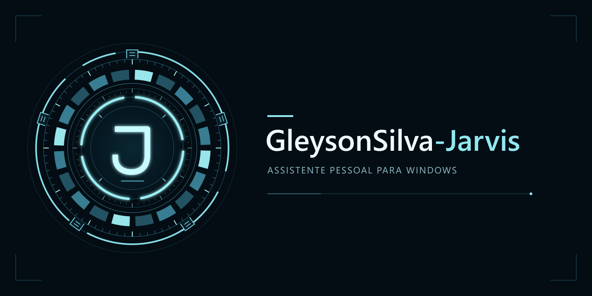

# Projeto GleysonSilva-Jarvis



Assistente pessoal para Windows com núcleo orbital azul, conversa pela voz configurada e ações locais que você pode revisar antes de autorizar.

**Revisão 0.3.0 em validação:** novo núcleo de filamentos luminosos e painel **Contexto**, aberto somente pelo botão. O painel reúne clima da Open-Meteo e execuções locais do perfil com fonte e horário; não acrescenta transcrições, narração ou cartões à tela principal.

O núcleo é uma implementação original em Canvas, inspirada na estética orbital das demonstrações públicas de Lucas Victor. Não contém código ou assets do produto dele. O centro fica vazio, sem faixa de texto nem anéis mecânicos. A mesma cor azul acompanha todos os estados; brilho e expansão respondem ao microfone e ao áudio reproduzido. O desenho respeita movimento reduzido e limita atualização e resolução para controlar o custo de renderização.

**Código-fonte:** [Gleysonp-Dev/GleysonSilva-Jarvis](https://github.com/Gleysonp-Dev/GleysonSilva-Jarvis), branch `main`. As verificações finais e o pacote Windows da 0.3.0 ainda precisam ser registrados. Os **229 testes e a abertura nativa aprovados no CI pertencem à base 0.2.3**, não comprovam os novos recursos. Não há release assinada nem validação completa em instalação limpa ou no hardware do usuário.

Saudação e conversa por voz continuam usando áudio e pulsação, sem falas ou transcrições no painel **Conversa**. Mensagens digitadas e suas respostas permanecem visíveis. A voz aprovada mantém reprodução a **0,95×**, altura preservada e efeito metálico fixo **0,78**. Memórias são preferências explícitas por perfil, revisáveis e apagáveis; não são retreinamento do modelo.

## O que está implementado

| Recurso | Comportamento do código atual |
| --- | --- |
| Núcleo orbital | Filamentos azuis originais, centro vazio e pulso reativo; sem texto central, grade ou telemetria decorativa. |
| Contexto sob demanda | Botão **Contexto** abre clima e atividade local. Abrir/atualizar não liga o microfone, não gera fala e não chama um modelo de linguagem. |
| Clima com origem | Tempo atual e previsão de hoje, horários da observação/consulta, atribuição e indicação de cache. Funciona com cidade configurada, mesmo sem saudação automática ou chave ElevenLabs. |
| Atividade do perfil | Contagem por estado sobre um snapshot de até 100 execuções recentes e lista de até oito; é registro local, sem eventos de agenda. |
| Texto com OpenAI | Responses com streaming, histórico limitado e ferramentas. |
| Conversa com a voz Jarvis | Microfone via OpenAI Realtime; respostas em texto são sintetizadas pela ElevenLabs com a voz configurada. A saída de áudio OpenAI é desativada. O novo fluxo completo ainda precisa de teste real. |
| Saudação e clima | **Iniciar Jarvis** prepara cumprimento pelo relógio do PC, tempo atual, previsão de hoje e “Em que posso ajudá-lo agora, senhor?”. Narração por áudio/pulsação e atribuição Open-Meteo compacta, sem transcrição no painel. |
| Voz aprovada | Clone ElevenLabs já criado com autorização. Reprodução local a 0,95×, altura preservada e tom metálico fixo no preset 0,78; sem controles de ajuste. |
| Espera local opcional | Duas palmas pelo Web Audio; palavra “Jarvis” pelo reconhecedor offline System.Speech no Windows, quando disponível. Pausa a espera durante fala e uso ativo do microfone. |
| Início no Windows | Opção desativada por padrão; disponível no aplicativo Windows empacotado. Inicia ao entrar na conta do Windows, em espera quando configurado; não opera antes do login. |
| Música da recepção | Arquivo do usuário importado privadamente; prévia atual com a saudação ouvida e aprovada. Nenhuma faixa padrão é distribuída. |
| Amostra fixa | **Ajustes → Saudação → Amostra fixa da voz** toca um MP3 de apresentação, sem API ou microfone. Não contém clima atual. |
| Teste de microfone | Mede sinal local e pulsa o núcleo sem enviar áudio ao provedor. |
| Câmera | Prévia por clique, independente dos modelos faciais. |
| Reconhecimento facial | Opcional: Python, YuNet/SFace, cadastro voluntário e consistência temporal. Sugere um perfil; não autoriza ações. |
| Arquivos | Prévia no primeiro nível da pasta autorizada, agrupamento por extensão, filtro por mês, confirmação, movimentos registrados e restauração condicionada. |
| Aplicativos | Adaptadores limitados para Calculadora, Bloco de Notas, VS Code e navegador, com executáveis cadastrados. |
| Persistência | SQLite para memórias, tarefas, procedimentos e efeitos; reiniciar não repete automaticamente ações interrompidas. |

Google Calendar, agenda, e-mail e notícias ainda não estão integrados. A primeira etapa do briefing é o painel de fontes sob demanda; um resumo falado com essas integrações pertence à próxima fase. Controle visual universal de aplicativos, terminal irrestrito, casa conectada, editor completo de automações e atualização automática também continuam fora do escopo. Não há benchmark que demonstre exclusividade, superioridade geral ou resposta instantânea.

## Começar pelo código-fonte

Requisitos: **Windows, Node.js 24 ou superior e npm**. Python não é necessário para texto, voz ou prévia da câmera. Instalação de dependências e serviços externos exigem conexão.

Na raiz do projeto:

```text
npm install
npm start
```

O segundo comando compila a interface e abre o Electron. O roteiro [AI_INSTALL.md](AI_INSTALL.md) orienta uma instalação assistida e o registro dos testes.

Para testar a 0.3.0 neste estágio, use o código-fonte da branch `main`. O executável **GleysonSilva-Jarvis-0.2.3-Windows.exe** é uma entrega anterior e não contém o novo núcleo nem Contexto. O pacote 0.3.0 e sua abertura real ainda precisam ser verificados antes de indicá-lo como download. A presença de um processo ou o sucesso do empacotamento, isoladamente, não bastam.

### Configuração e primeira conversa

1. Abra **Ajustes** e informe a chave OpenAI no campo mascarado. Não cole credenciais na conversa.
2. Os padrões são `gpt-5.4-mini` para texto e `gpt-realtime` para entrada de voz e geração de texto. O acesso depende da conta.
3. Salve e faça uma pergunta por texto. Digitar não liga o microfone nem aciona fala automaticamente.
4. Em **Saudação e tempo**, configure privadamente a chave ElevenLabs e o identificador da voz já criada. A conversa falada exige os dois provedores; falta de voz ou falha de síntese informa indisponibilidade, sem trocar para uma voz OpenAI ou do navegador.
5. Use **Testar microfone** para conferir captura local. Depois inicie a conversa por voz e confirme resposta adequada realmente ouvida, pulsação e interrupção, sem transcrição no painel. Encerre e confira a liberação do dispositivo.

O limite padrão da sessão é dez minutos, ajustável entre um e trinta. A conversa pode consumir OpenAI e ElevenLabs. A troca do caminho de voz foi implementada após um ensaio ouvir a voz OpenAI `marin`; esse resultado anterior não comprova a nova conversa com o clone.

### Consultar Contexto

Clique em **Contexto** na barra lateral. Configure a cidade em Ajustes para consultar o tempo; essa leitura não exige chaves OpenAI/ElevenLabs nem a saudação automática habilitada. A consulta informa temperatura, condição, mínima/máxima e chance de chuva quando a fonte fornece um valor válido. Os horários distinguem a observação meteorológica e a obtenção da resposta. O botão **Atualizar** faz outra leitura, respeitando o cache.

O cache dura até dez minutos e só é reutilizado para as mesmas coordenadas, fuso e data local, com observação de até três horas de idade. Resposta inválida ou fonte indisponível produz um estado explícito, sem previsão inventada. A atividade vem do banco local do perfil: as contagens abrangem até 100 execuções recentes e a lista mostra até oito. Não representa compromissos, tarefas do Google ou todos os eventos da conta.

Fechar o painel, mudar o perfil ou encerrar a janela cancela a leitura e descarta respostas atrasadas. Consulte [Contexto: fontes, privacidade e limites](docs/context.md).

### Recepção, espera e música

Configure a cidade privadamente e use **Iniciar Jarvis** para preparar uma saudação com clima. **Ouvir saudação** repete o áudio preparado sem nova consulta ou síntese. Um arquivo gravado conserva o boletim do momento da geração; reproduzi-lo não atualiza o tempo.

Em **Ajustes → Início e espera**, escolha conscientemente manter o microfone em espera, usar duas palmas e/ou a palavra “Jarvis”. O detector de palmas processa o sinal no computador. A palavra exige um reconhecedor de idioma compatível instalado no Windows e não usa Web Speech do navegador. A espera não abre uma conversa com a OpenAI; o gatilho inicia a recepção com clima.

Na revisão 0.2.3, os filtros de palmas e palavra ficaram mais conservadores. O reconhecimento nativo verifica frase, palavra, duração, acomodação inicial e intervalo entre ativações; seus escores são relativos, sem equivaler à probabilidade de intenção. O evento de repetição relatado não possui registro que identifique qual detector o disparou. É necessário ensaiar fala, TV e impactos reais; não há garantia de ausência de falsos positivos.

**Iniciar ao entrar no Windows** é uma opção separada para a versão empacotada. Instalar o código não ativa captura em segundo plano nem registra início automático. O navegador de teste não altera o login do Windows e não oferece a palavra de ativação nativa.

A música depende de um arquivo fornecido pelo usuário e mantido privado. A prévia atual com a saudação foi ouvida e aprovada, com ganho de 0,35 na introdução e 0,22 sob a fala. O ensaio na recepção ao vivo ainda está pendente. Não existe trilha padrão nesta entrega. Consulte [Espera e início no Windows](docs/standby.md) para requisitos, pausa, encerramento e limitações.

O GitHub contém a documentação e a [amostra de voz autorizada](assets/voice/jarvis-demo.mp3), que reproduz uma frase fixa. A música recebida permanece privada e não é distribuída no repositório nem no pacote. Chaves, ID da voz e gravação de referência também não acompanham a amostra; novas falas exigem configuração privada da ElevenLabs.

### Primeira ação

Escolha uma pasta de ensaio com arquivos descartáveis. Peça uma prévia de organização, revise a proposta e, se necessário, corrija “somente os modificados neste mês” antes de autorizar.

O registro distingue resultado verificado, falha, cancelamento e resultado não verificado. Interromper evita os próximos passos; não desfaz efeitos concluídos. A restauração é uma nova proposta e recusa conflitos ou arquivos alterados.

## Testar no navegador local

```text
npm run test:local
```

Abra `http://127.0.0.1:47832` no mesmo computador. O modo funcional usa microfone/câmera reais, serviços configurados e `local-data/workspace` como pasta de ensaio. O servidor aceita somente loopback e a bridge de sua origem. Não o exponha na rede.

Depois de instalar as dependências, [INICIAR-TESTE.cmd](INICIAR-TESTE.cmd) oferece o mesmo ensaio na porta `47833`, mantendo a janela do servidor aberta. **As chaves ficam apenas na memória do processo** e são perdidas ao encerrá-lo. Não reinicie o servidor durante uma configuração ou ensaio em curso.

Esse modo não oferece adaptadores de aplicativos Windows, início no login, palavra de ativação nativa nem comprova armazenamento protegido do Electron. Navegadores também podem limitar captura e temporizadores em segundo plano. `npm run preview` é somente uma prévia visual sem bridge.

## Reconhecimento facial opcional

Siga [Visão local: instalação e modelos](services/vision/README.md), com Python 3.12 recomendado e ambiente virtual próprio. Dependências, modelos, cadastros e imagens ficam fora do repositório. O worker usa pipe privado, não abre rede e não envia quadros ou vetores aos provedores.

No equipamento ensaiado, a câmera produziu prévia real **640×480** e foi encerrada. **Identificação permanece indisponível:** OpenCV e os pesos faciais ainda não estão instalados. Prévia de webcam não comprova reconhecimento.

O cadastro é voluntário. A pessoa confirma o perfil sugerido; reconhecimento nunca substitui autorização de ferramentas. Webcam RGB pode ser enganada por imagem/vídeo e não é autenticação segura.

## Dados e permissões

- No Electron Windows, as chaves OpenAI e ElevenLabs são protegidas pelo mecanismo do sistema no processo principal, fora do checkout. A interface não recebe os valores salvos de volta. Essa proteção ainda exige ensaio nativo.
- Texto, histórico necessário, preferências do perfil e resultados de ferramentas podem ser enviados à OpenAI. Uma conversa de voz aberta transmite áudio do microfone à OpenAI; o texto a narrar vai à ElevenLabs.
- Teste local de microfone, palmas, palavra nativa e visão são processamento local. A espera mantém acesso ao microfone enquanto ativada; pode ser pausada.
- A consulta de clima envia as coordenadas configuradas à Open-Meteo. A fonte e a licença acompanham o resultado.
- Contexto lê apenas clima e metadados de execuções do perfil. Não envia essa leitura à OpenAI/ElevenLabs, não acessa contas Google e não narra automaticamente o resultado.
- Não publique chaves, banco, cidade privada, identificador da voz, rostos, gravação de referência, música privada ou arquivos de ensaio. Um MP3 autorizado não inclui um modelo exportável da voz.
- A pasta selecionada limita o executor. O modelo não recebe terminal livre nem pode inventar autoridade para ferramentas.

Detalhes em [Arquitetura](docs/architecture.md), [OpenAI](docs/openai.md), [ElevenLabs](docs/elevenlabs.md) e [Voz e câmera](docs/voice-and-camera.md).

## Verificação e evidências

```text
npm run verify
```

**0.3.0:** verificações finais em andamento. Os resultados históricos abaixo permanecem vinculados às revisões correspondentes; não são evidência de hardware, provedores ou pacote da 0.3.0.

O [CI da base 0.2.0, commit 63cf001](https://github.com/Gleysonp-Dev/GleysonSilva-Jarvis/actions/runs/39159266409), aprovou **214 testes**, TypeScript, build e empacotamento Windows. O [CI do volume aprovado, e0d8ddaa](https://github.com/Gleysonp-Dev/GleysonSilva-Jarvis/actions/runs/39160538917), também concluiu testes, TypeScript, build e empacotamento com sucesso; seu artefato inclui o ajuste. A baseline ba0680 havia aprovado 147 testes.

**Falha nativa confirmada no 0.2.0:** processo ativo sem janela. O `await app.whenReady()` no topo do módulo ESM bloqueava a inicialização no Electron 44.9.0. A revisão 0.2.1 move a espera para uma função de inicialização. A falha não veio de autostart/hardware; Electron 44.9.0/Node 24.22 carregou SQLite corretamente. O novo teste nativo local parou antes do código do aplicativo por restrição de permissões do ambiente, sem comprovar abertura corrigida.

A revisão 0.2.0 passou localmente por **214 testes**, zero falhas/skips, com Python configurado, TypeScript estrito e build aprovados. A interface de ajustes foi inspecionada no navegador: opções nativas indisponíveis ficaram desabilitadas e a configuração da espera foi preservada. Testes com substitutos e inspeção de controles não comprovam ativação física.

A revisão **0.2.1 passou por 218 testes**, zero falhas/skips, TypeScript, build, empacotamento e **teste nativo real no [CI Windows 8a074e7](https://github.com/Gleysonp-Dev/GleysonSilva-Jarvis/actions/runs/39162376494)**. O teste confirmou aplicação pronta, janela, DOM, preload, boot e pacote em cerca de dois segundos. O bloqueio por permissões do ambiente local foi um resultado separado e não ocorreu nesse CI.

A revisão **0.2.2 passou por 221 testes**, zero falhas/skips, TypeScript, build, pacote e **abertura nativa real no [CI d72c4887](https://github.com/Gleysonp-Dev/GleysonSilva-Jarvis/actions/runs/39164458465)**. O ensaio visual com serviços substituídos confirmou saudações sem mensagens no painel, uma fonte meteorológica compacta e preservação das mensagens digitadas. Isso não é um teste de provedor ou hardware.

A revisão **0.2.3 passou por 229 testes**, zero falhas/skips, TypeScript, build, pacote e abertura nativa real no [CI 5733b37](https://github.com/Gleysonp-Dev/GleysonSilva-Jarvis/actions/runs/39166025134). As regressões de fechamento exercitam o principal real com Electron/OS substituídos; filtros de ativação usam sinais/eventos sintéticos. X encerra e corta o áudio antes de esperar a limpeza; minimizar preserva a espera. A abertura isolada no CI não comprova o teste físico desse fechamento ou dos novos filtros, que permanece pendente.

No ensaio real foram confirmados texto OpenAI correto, microfone com nível e liberação, prévia de câmera 640×480 e parada, saudação aprovada e áudio OpenAI Realtime ouvido. Este último usou `marin`, voz diferente da desejada, motivando a troca para ElevenLabs.

**Ainda não confirmados no aplicativo nativo do usuário:** nova conversa completa com o clone, captura/liberação do microfone, ativação por palmas/palavra, retorno da espera, início no login e persistência protegida das chaves. A captura de tela da base 0.2.1, o ensaio visual sem provedor e o CI da revisão 0.2.2 não exercitaram esses recursos. Não há latência comparável medida nem acurácia facial demonstrada. Veja [Validação](docs/validation.md), [Plano de testes](docs/test-plan.md) e [Roadmap](docs/roadmap.md).

## Estrutura

```text
apps/desktop/           Electron, bridge limitada, ajustes e adaptadores Windows
apps/desktop/renderer/  React, HUD Canvas, WebRTC, áudio e detector local de palmas
apps/desktop/platform/  reconhecimento offline Windows
packages/runtime/      política, SQLite, ferramentas e execução
packages/openai/       Responses, Realtime e erros
packages/speech/       síntese da conversa, correlação e cancelamento
packages/greeting/     cumprimento, clima e narração de abertura
packages/context/      leitura sob demanda do clima e das execuções locais
packages/elevenlabs/    transporte, clonagem autorizada e TTS
services/vision/       worker facial Python opcional
tests/                 testes automáticos com rede/hardware substituídos
docs/                  arquitetura, uso, validação e evolução
```

## Contribuir e distribuir

Relate sistema, versão, superfície, reprodução e resultado esperado, sem dados pessoais ou segredos. Ferramentas novas precisam de argumentos estritos, acesso limitado, aprovação de efeitos e evidência de resultado.

O código usa Apache-2.0; dependências e modelos conservam suas licenças. Projeto independente, sem associação com Marvel, Disney, OpenAI ou ElevenLabs. O [aviso da amostra pública](assets/voice/README.md) registra origem sintética e distribuição autorizada. Revise identidade e licenças antes de uso comercial. Responsável: **Gleysonp-Dev**.
