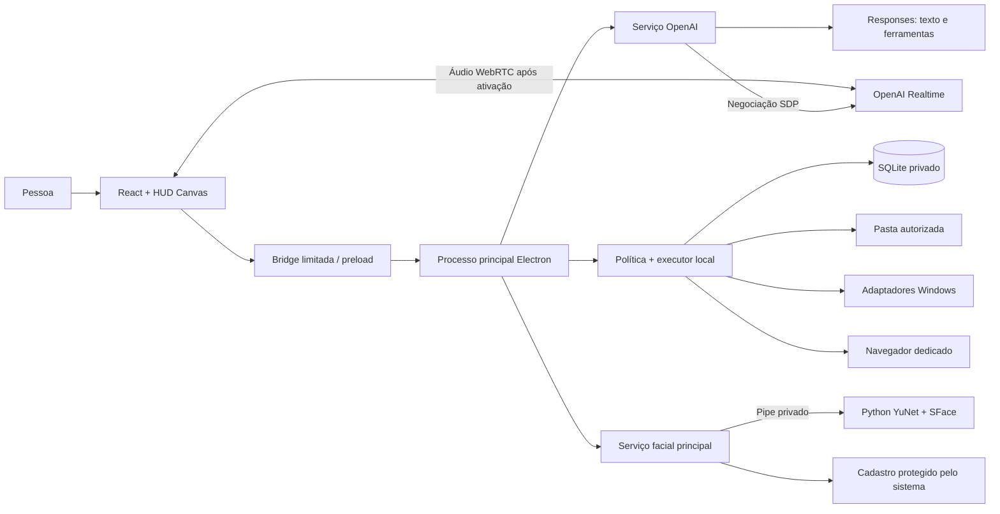

# Arquitetura — Projeto GleysonSilva-Jarvis

O MVP separa interface, comunicação com modelos, política de execução e reconhecimento facial. O modelo interpreta a intenção e propõe ferramentas; o executor local decide quais operações aceita e registra o resultado observado. Um texto gerado não é tratado como confirmação de efeito no computador.

## Componentes e fronteiras

| Camada | Responsabilidade | Não recebe como autoridade |
| --- | --- | --- |
| Renderer | Conversa, HUD, controles, permissões de captura, WebRTC e apresentação de aprovações. | Chave salva, Node, execução de shell ou embeddings faciais. |
| Preload | Expor métodos explícitos, filtrar IPC e entregar eventos. | Código arbitrário fornecido pelo modelo ou página. |
| Processo principal | Validar origem/argumentos, guardar configuração, ligar serviços, vincular perfil e cancelar sessões. | Um perfil escolhido unilateralmente por uma ferramenta. |
| Provider OpenAI | Responses/Realtime, streaming, memória recuperada e delegação de ferramentas. | Autoridade para ignorar a política local. |
| Runtime | Limites de pasta, confirmação, idempotência, efeitos e registro persistente. | Instruções embutidas em arquivos, seleção de página ou texto de memória. |
| Worker facial | Detectar, alinhar e extrair vetores de um quadro. | Nomes, chaves, banco de tarefas ou acesso à rede. |

O Electron usa `contextIsolation`, sandbox e `nodeIntegration:false`. A interface é servida pela origem própria `jarvis://app`; o processo principal aceita IPC somente do frame principal esperado. Navegações, janelas e permissões passam por regras específicas. O navegador dedicado tem uma sessão separada e não recebe a bridge do aplicativo.

## Texto e ferramentas

1. A interface envia texto, um histórico limitado, perfil e identificador de execução.
2. O principal confirma o perfil ativo e abre um controlador de cancelamento.
3. O serviço recupera preferências explícitas do perfil e envia o contexto necessário à OpenAI. Memória e conteúdo observado são tratados como dados.
4. O parser recebe SSE incremental, incluindo fragmentos de UTF-8. A interface acrescenta os deltas à mensagem correspondente.
5. Uma resposta completada pode solicitar uma ferramenta conhecida. Argumentos são validados contra o contrato local.
6. Quando houver efeito que exige decisão, o runtime publica uma proposta. A aprovação pertence àquela execução, perfil e geração da sessão.
7. O adaptador executa e informa sucesso verificado, falha ou resultado não verificado. O serviço entrega o resultado ao modelo para a continuação.

O provider limita turnos, quantidade de ferramentas e prazo total. Repetir uma chamada já registrada não repete automaticamente seu efeito. Erros externos e nativos são convertidos em mensagens curtas; cabeçalhos, chave e corpos brutos não voltam à interface.

## Voz, pulsação e interrupção

A captura só começa após o controle de voz ser acionado. O renderer pede microfone com cancelamento de eco e redução de ruído, cria `RTCPeerConnection` e envia o SDP ao principal. O principal negocia com o provedor usando a chave protegida e devolve apenas o SDP de resposta. O áudio circula no WebRTC; eventos e ferramentas usam o canal de dados.

O áudio capturado e o áudio remoto reproduzido possuem analisadores locais. O HUD usa seus envelopes reais, preservando o ciano e o título central. Uma ferramenta em andamento possui cadência visual própria. O teste local de microfone usa o mesmo tipo de análise e não abre sessão com o provedor.

O cliente deduplica eventos e `call_id`. Uma chamada de função é delegada à bridge; o resultado volta como `function_call_output`. Só uma continuação ainda ativa dispara `response.create`. Respostas interrompidas não podem reiniciar a tarefa quando um resultado atrasado chega.

Interrupção de áudio envia `response.cancel` antes de `output_audio_buffer.clear` quando aplicável. O cliente também interrompe a reprodução e cancela execuções pendentes. Cada nova resposta usa um identificador de execução novo: o identificador cancelado não é reaproveitado. Efeitos completos continuam no registro; o cancelamento não promete reversão do passado.

Encerrar voz libera microfone, tracks remotas, contexto de áudio, conexão e temporizadores. O limite de sessão é de um a trinta minutos. Mudança de configuração/perfil publica `session.reset`; a interface fecha voz, teste de microfone, câmera e aprovações anteriores.

## Arquivos e resultados verificáveis

A organização opera somente no primeiro nível da pasta autorizada. A proposta agrupa extensões e pode filtrar pela data de modificação do mês atual. A prévia apresenta os movimentos antes de qualquer alteração.

O runtime rejeita caminhos externos, links/junções e arquivos que não satisfazem suas regras. Antes do efeito, registra a identidade e o conteúdo do arquivo. O movimento evita sobrescrita de destino; a sequência e os estados ficam registrados. Divergência ou efeito parcial exige revisão em vez de anúncio de sucesso.

Restauração é uma proposta separada, baseada no histórico dos movimentos. Arquivo alterado, destino ocupado ou identidade divergente provocam recusa. Ao reiniciar, tarefas pendentes tornam-se interrompidas e não são retomadas automaticamente.

Os adaptadores Windows aceitam um conjunto pequeno de ações e aplicativos cadastrados. O fato de iniciar um processo pode ser insuficiente para confirmar a pasta ou janela exibida; nesses casos o resultado permanece não verificado. Não existe terminal livre nem automação visual universal.

## Memória e persistência

SQLite mantém memórias por perfil, tarefas, procedimentos, chamadas, planos, passos e eventos. A recuperação de preferências alimenta pedidos novos e sessões de voz novas; não atualiza os pesos dos modelos. Uma sessão de voz já aberta precisa ser reiniciada após mudança relevante de contexto.

Memória pode ser adicionada diretamente pelo usuário ou proposta pelo modelo com confirmação. O painel permite revisão e exclusão. O armazenamento de procedimentos existe como base para evolução; um editor completo e versionamento de procedimentos ainda pertencem ao roadmap.

O banco e sua pasta são privados em relação ao repositório, mas isso não significa que todo o SQLite está cifrado. Preferências, tarefas e detalhes de efeitos devem ser tratados como conteúdo pessoal. Alguns textos privados são omitidos do registro de eventos; isso não substitui uma política completa de exportação e retenção.

## Câmera e identidade

O painel Presença pede acesso ao vídeo somente por clique. A prévia pode funcionar sem Python ou pesos. Com o backend disponível, um quadro reduzido segue ao principal e ao worker por pipe privado. O worker detecta com YuNet, alinha cinco pontos e extrai vetores SFace normalizados. Ele não grava a imagem nem recebe nomes.

O principal mantém o cadastro protegido e aceita o reconhecimento somente com margem, limiar e consistência temporal. Cadastro exige três amostras consistentes. Múltiplos rostos, desconhecidos ou ambiguidade preservam uma apresentação neutra. O renderer recebe dados de apresentação; não recebe embeddings.

A pessoa confirma o perfil sugerido. Reconhecimento não autentica, não libera dados e não concede permissão para ferramentas. Webcam RGB não oferece prova de vida. Fechar o painel cancela o ciclo, descarta respostas antigas e libera a câmera.

## Dados e modos de execução

| Dado | Electron para Windows | Teste local no navegador |
| --- | --- | --- |
| Chave OpenAI | Protegida por `safeStorage` no principal; arquivo fora do checkout. | Temporária na memória do processo local. |
| Memórias e tarefas | SQLite privado do aplicativo. | Dados locais de ensaio, excluídos do Git. |
| Pasta operada | Selecionada explicitamente, com fallback privado de trabalho. | `local-data/workspace`, pasta de ensaio gerada. |
| Programas Windows | Adaptadores limitados e executáveis cadastrados. | Indisponíveis. |
| Áudio de conversa | Enviado ao provedor durante sessão de voz. | Mesmo requisito quando a sessão real é iniciada. |
| Teste de microfone | Análise local sem sessão paga. | Análise local sem sessão paga. |
| Rostos | Fluxo local opcional; cadastro protegido pelo mecanismo do sistema. | Não comprova a proteção/persistência nativa do Electron. |

A chave permanente não chega ao bundle nem retorna em `boot()`. Texto, memórias necessárias e resultados de ferramentas podem sair do dispositivo para a OpenAI. `store:false` no Responses não equivale a garantia geral de retenção zero. A voz sintetizada inicial é `marin`; o trabalho de voz personalizada ElevenLabs é separado e não altera a fronteira de autoridade das ferramentas.

## Verificação e limites atuais

Testes offline cobrem contratos, streaming, cancelamento, caminhos, idempotência e protocolo facial com backends substituídos. A compilação verifica o renderer. Esses resultados não medem a rede neural real, latência percebida, cifragem nativa, comportamento de todos os programas Windows ou executável instalado.

O [plano de testes](test-plan.md) define ensaios separados com conta, microfone, som audível, webcam, pessoas voluntárias, arquivos descartáveis e instalação limpa. O [roadmap](roadmap.md) usa essas evidências como critério para ampliar capacidades.
