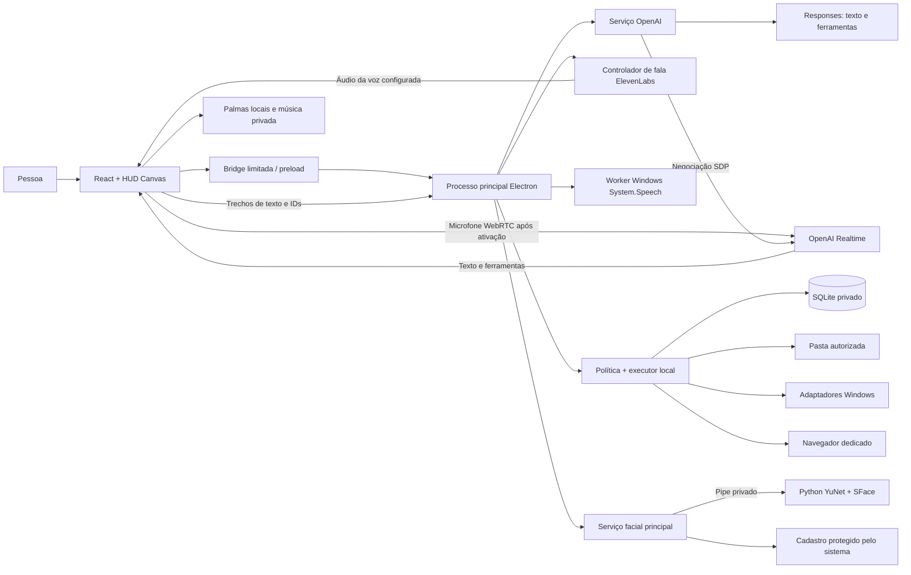

# Arquitetura — Projeto GleysonSilva-Jarvis

O MVP 0.2.0 separa interface, comunicação com modelos, síntese de fala, política de execução e reconhecimento facial. O modelo interpreta e propõe ferramentas; o executor decide quais operações aceita e registra o resultado. Texto gerado não confirma efeito no computador. A nova conversa e os gatilhos nativos ainda precisam de validação real completa.

## Componentes e fronteiras

| Camada | Responsabilidade | Não recebe como autoridade |
| --- | --- | --- |
| Renderer | Conversa, HUD, captura, WebRTC, fila/reprodução de fala, palmas e aprovações. | Chave salva, Node, shell ou embeddings faciais. |
| Preload | Expor métodos explícitos, filtrar IPC e entregar eventos. | Código arbitrário fornecido pelo modelo ou página. |
| Processo principal | Validar origem/argumentos, guardar configuração, ligar serviços, vincular perfil e cancelar sessões. | Um perfil escolhido unilateralmente por uma ferramenta. |
| Provider OpenAI | Responses/Realtime, streaming, memória recuperada e delegação de ferramentas. | Autoridade para ignorar a política local. |
| Controlador de fala | Texto limitado, síntese ElevenLabs, correlação e cancelamento por geração. | Poder de executar ferramentas ou trocar silenciosamente de voz. |
| Runtime | Limites de pasta, confirmação, idempotência, efeitos e registro persistente. | Instruções embutidas em arquivos, seleção de página ou texto de memória. |
| Worker facial | Detectar, alinhar e extrair vetores de um quadro. | Nomes, chaves, banco de tarefas ou acesso à rede. |

O Electron usa `contextIsolation`, sandbox e `nodeIntegration:false`. A interface é servida pela origem própria `jarvis://app`; o processo principal aceita IPC somente do frame principal esperado. Navegações, janelas e permissões passam por regras específicas. O navegador dedicado tem uma sessão separada e não recebe a bridge do aplicativo.

## Texto e ferramentas

1. A interface envia texto, um histórico limitado, perfil e identificador de execução.
2. O principal confirma o perfil ativo e abre um controlador de cancelamento.
3. O serviço recupera preferências explícitas do perfil e envia o contexto necessário à OpenAI. Memória e conteúdo observado são tratados como dados.
4. O parser recebe SSE incremental, incluindo fragmentos de UTF-8. A interface acrescenta os deltas à mensagem correspondente.
5. Uma resposta completada pode solicitar uma ferramenta conhecida. Argumentos são validados contra o contrato local.
6. Quando houver efeito que exige decisão, o runtime publica uma proposta. A aprovação pertence àquela execução, perfil e geração da sessão.
7. O adaptador executa e informa sucesso verificado, falha ou resultado não verificado. O serviço entrega o resultado ao modelo para a continuação.

O provider limita turnos, quantidade de ferramentas e prazo total. Repetir uma chamada já registrada não repete automaticamente seu efeito. Erros externos e nativos são convertidos em mensagens curtas; cabeçalhos, chave e corpos brutos não voltam à interface.

## Voz, pulsação e interrupção

A conversa falada começa pelo controle de voz. O renderer pede microfone, cria `RTCPeerConnection` e envia SDP ao principal. O principal negocia com chave protegida e devolve SDP. O microfone segue para a OpenAI no WebRTC; a sessão solicita saída em texto e ferramentas. Qualquer track de áudio remota inesperada é desativada/encerrada, sem reprodução.

Trechos completos do texto são enfileirados para `packages/speech`, com perfil, execução e ID de trecho. O principal valida a configuração, sintetiza na ElevenLabs e retorna áudio limitado, sem chave/ID de voz. O cliente prepara/reproduz os trechos em ordem; cancelamento invalida a geração e seus resultados atrasados. Eventos `.done` não enfileiram uma nova fala. Erro de síntese mantém texto/aviso; não troca para voz OpenAI ou do navegador.

Captura e fala local possuem analisadores. O HUD usa os envelopes preservando ciano e título, e uma cadência própria para ferramentas. A narração usa reprodução fixa 0,95× com altura preservada e efeito 0,78. O teste de microfone é local, sem provedor. A conversa completa com essa nova saída ainda exige aceite real.

O cliente deduplica eventos e `call_id`. Uma chamada de função é delegada à bridge; o resultado volta como `function_call_output`. Só uma continuação ainda ativa dispara `response.create`. Respostas interrompidas não podem reiniciar a tarefa quando um resultado atrasado chega.

Interromper solicita `response.cancel`, aborta síntese/reprodução e cancela execuções pendentes. Cada resposta usa nova execução; um identificador cancelado não é reaproveitado. Resultados atrasados não podem voltar a falar ou agir. Efeitos completos permanecem no registro; cancelamento não reverte o passado.

Encerrar voz libera microfone, tracks remotas, contexto de áudio, conexão e temporizadores. O limite de sessão é de um a trinta minutos. Mudança de configuração/perfil publica `session.reset`; a interface fecha voz, teste de microfone, câmera e aprovações anteriores.

## Espera, login e recepção

`startAtLogin` e `standbyEnabled` começam desligados. O pacote Windows pode registrar seu executável estável para iniciar depois do login. Quando configurado para espera, o app aguarda gatilho; não é serviço antes do login. O principal mantém bandeja, pausa/retorno e worker offline System.Speech limitado à palavra “Jarvis”, dependente de idioma instalado.

O renderer analisa duas palmas por Web Audio, sem enviar áudio à nuvem; o worker de palavra também é local. Esses gatilhos não abrem conversa OpenAI. Antes de recepção/música e durante uso ativo do microfone, o controlador pausa a espera. A captura retorna somente se a intenção de espera continuar ativa; limpeza e gerações descartam callbacks antigos.

O serviço de saudação usa relógio do PC, coordenadas privadas e Open-Meteo, com atribuição. A síntese usa a mesma voz ElevenLabs. Cancelar também aborta a preparação no backend. Uma fonte musical privada pode acompanhar a recepção até fim/interrupção, mas não há faixa padrão e o arquivo ainda não foi fornecido.

Detecção real, segundo plano, idioma, login e retorno não foram aprovados fisicamente. Navegador não altera login nem oferece o worker nativo. Consulte [Espera](standby.md).

## Arquivos e resultados verificáveis

A organização opera somente no primeiro nível da pasta autorizada. A proposta agrupa extensões e pode filtrar pela data de modificação do mês atual. A prévia apresenta os movimentos antes de qualquer alteração.

O runtime rejeita caminhos externos, links/junções e arquivos que não satisfazem suas regras. Antes do efeito, registra a identidade e o conteúdo do arquivo. O movimento evita sobrescrita de destino; a sequência e os estados ficam registrados. Divergência ou efeito parcial exige revisão em vez de anúncio de sucesso.

Restauração é uma proposta separada, baseada no histórico dos movimentos. Arquivo alterado, destino ocupado ou identidade divergente provocam recusa. Ao reiniciar, tarefas pendentes tornam-se interrompidas e não são retomadas automaticamente.

Os adaptadores Windows aceitam um conjunto pequeno de ações e aplicativos cadastrados. O fato de iniciar um processo pode ser insuficiente para confirmar a pasta ou janela exibida; nesses casos o resultado permanece não verificado. Não existe terminal livre nem automação visual universal.

## Memória e persistência

SQLite mantém memórias por perfil, tarefas, procedimentos, chamadas, planos, passos e eventos. A recuperação de preferências alimenta pedidos novos e sessões de voz novas; não atualiza os pesos dos modelos. Uma sessão de voz já aberta precisa ser reiniciada após mudança relevante de contexto.

Memória pode ser adicionada diretamente pelo usuário ou proposta pelo modelo com confirmação. O painel permite revisão e exclusão. O armazenamento de procedimentos existe como base para evolução; um editor completo e versionamento de procedimentos ainda pertencem ao roadmap.

O banco e sua pasta são privados em relação ao repositório, mas isso não significa que todo o SQLite está cifrado. Preferências, tarefas e detalhes de efeitos devem ser tratados como conteúdo pessoal. Alguns textos privados são omitidos do registro de eventos; isso não substitui uma política completa de exportação e retenção.

## Câmera e identidade

O painel Presença pede acesso ao vídeo somente por clique. A prévia pode funcionar sem Python ou pesos. Com o backend disponível, um quadro reduzido segue ao principal e ao worker por pipe privado. O worker detecta com YuNet, alinha cinco pontos e extrai vetores SFace normalizados. Ele não grava a imagem nem recebe nomes.

O principal mantém o cadastro protegido e aceita o reconhecimento somente com margem, limiar e consistência temporal. Cadastro exige três amostras consistentes. Múltiplos rostos, desconhecidos ou ambiguidade preservam uma apresentação neutra. O renderer recebe dados de apresentação; não recebe embeddings.

A pessoa confirma o perfil sugerido. Reconhecimento não autentica, não libera dados e não concede permissão para ferramentas. Webcam RGB não oferece prova de vida. Fechar o painel cancela o ciclo, descarta respostas antigas e libera a câmera.

## Dados e modos de execução

| Dado | Electron para Windows | Teste local no navegador |
| --- | --- | --- |
| Chaves OpenAI/ElevenLabs | Protegidas por `safeStorage` no principal; arquivo fora do checkout. | Temporárias na memória do processo local. |
| Memórias e tarefas | SQLite privado do aplicativo. | Dados locais de ensaio, excluídos do Git. |
| Pasta operada | Selecionada explicitamente, com fallback privado de trabalho. | `local-data/workspace`, pasta de ensaio gerada. |
| Programas Windows | Adaptadores limitados e executáveis cadastrados. | Indisponíveis. |
| Conversa | Microfone enviado à OpenAI; texto da resposta enviado à ElevenLabs. | Mesmo fluxo com ambos os provedores configurados. |
| Teste de microfone | Análise local sem sessão paga. | Análise local sem sessão paga. |
| Espera | Palmas e palavra locais; microfone ativo se habilitado. | Palmas locais, sujeito a limites de segundo plano; sem palavra nativa/login. |
| Música | Fonte privada escolhida pelo usuário. | Não há arquivo padrão; o ensaio não comprova seletor nativo. |
| Rostos | Fluxo local opcional; cadastro protegido pelo mecanismo do sistema. | Não comprova a proteção/persistência nativa do Electron. |

Chaves permanentes não chegam ao bundle nem retornam em `boot()`. Texto, memórias e resultados necessários podem sair para a OpenAI; texto narrado vai à ElevenLabs e coordenadas do clima à Open-Meteo. `store:false` não equivale a retenção zero. Configuração legada de voz OpenAI não seleciona a saída audível atual. A síntese nunca amplia a autoridade das ferramentas.

## Verificação e limites atuais

Testes offline cobrem contratos, streaming, cancelamento, arquivos, fala, gatilhos e protocolo facial com backends/dispositivos substituídos. O ensaio real anterior confirmou texto OpenAI, captura/liberação de microfone, webcam 640×480 e saída OpenAI marin ouvida. Esta última motivou a nova rota de voz, ainda sem aceite real completo. OpenCV e pesos faciais permanecem ausentes.

A revisão local passou por 214 testes, TypeScript e build; o CI 0.2.0 ainda está pendente no registro. Não houve execução física do EXE, login, ativação por palmas/palavra ou reconhecimento real. Consulte [Validação](validation.md).

O [plano de testes](test-plan.md) define ensaios separados com conta, microfone, som audível, webcam, pessoas voluntárias, arquivos descartáveis e instalação limpa. O [roadmap](roadmap.md) usa essas evidências como critério para ampliar capacidades.
