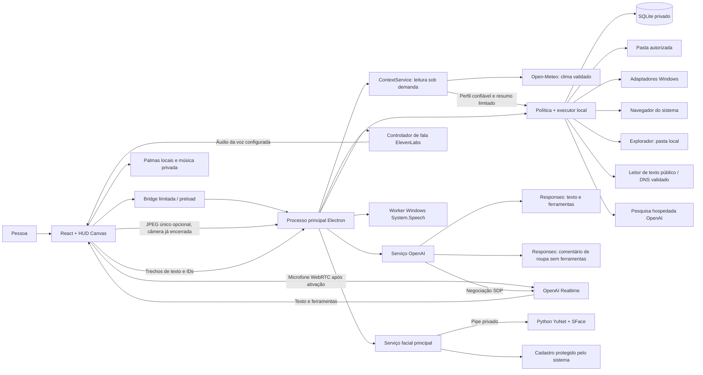

# Arquitetura — Projeto GleysonSilva-Jarvis

O MVP 0.5.2 separa interface, leitura de contexto/web, comunicação com modelos, síntese de fala, política de execução e reconhecimento facial. A recepção encadeia saudação com música, um quadro opcional para comentar roupa e entrada opcional em conversa contínua. A preparação da roupa começa durante a reprodução da saudação, mas a narração aguarda seu fim. A abertura genérica de navegador usa o padrão do Windows sem cadastro manual de executável. Preserva o núcleo 0.3.1 aprovado pelo autor, a voz e os acessos desktop/web da 0.4.0. O modelo interpreta e propõe ferramentas; o executor decide quais operações aceita e registra o resultado. Texto gerado não confirma efeito no computador.

O [CI 475f3f4 da 0.4.0](https://github.com/Gleysonp-Dev/GleysonSilva-Jarvis/actions/runs/39523160110) aprovou **343/343 testes, zero falhas/skips**, TypeScript, build, pacote e abertura nativa real daquela versão. [CI fced652 da 0.5.0](https://github.com/Gleysonp-Dev/GleysonSilva-Jarvis/actions/runs/39526640376) aprovado: **388/388 testes, zero falhas/skips**, TypeScript, build, pacote e abertura nativa real, com os limites do ensaio físico registrados em [Validação](validation.md). Guia de comandos preservados em [Acesso desktop e web](desktop-access.md).

[CI b8c6c8f da 0.5.1](https://github.com/Gleysonp-Dev/GleysonSilva-Jarvis/actions/runs/39529034939) aprovado: **402/402 testes, zero falhas/skips**, TypeScript, build, pacote e abertura nativa real. Os ensaios físicos de navegador e intervalo entre falas continuam pendentes. As contagens anteriores pertencem aos respectivos commits.

## Componentes e fronteiras

| Camada | Responsabilidade | Não recebe como autoridade |
| --- | --- | --- |
| Renderer | Conversa, núcleo orbital azul, Contexto sob demanda, fontes compactas, captura limitada, WebRTC, fila/reprodução de fala, palmas e sequência da recepção. | Chave salva, Node, shell ou embeddings faciais. |
| Preload | Expor métodos explícitos, filtrar IPC e entregar eventos. | Código arbitrário fornecido pelo modelo ou página. |
| Processo principal | Validar origem/argumentos, guardar configuração, ligar serviços, vincular perfil e cancelar sessões. | Um perfil escolhido unilateralmente por uma ferramenta. |
| Provider OpenAI | Responses/Realtime, streaming, memória recuperada, ferramentas e chamada isolada de roupa. | Autoridade para ignorar a política local; a chamada de roupa não recebe ferramentas/histórico. |
| Controlador de fala | Texto limitado, síntese ElevenLabs, correlação e cancelamento por geração. | Poder de executar ferramentas ou trocar silenciosamente de voz. |
| ContextService | Clima e atividade local observados, com fonte, horário e estados parciais. | Perfil recebido da interface, autoridade para agir ou acesso a chaves de voz. |
| Runtime | Limites de pasta, confirmação, idempotência, efeitos e registro persistente. | Instruções embutidas em arquivos, seleção de página ou texto de memória. |
| Leitor web | Texto público HTTP(S), DNS/destino, redirecionamentos, tamanho e prazo limitados. | Cookies, login, JavaScript ou instruções encontradas na página. |
| Worker facial | Detectar, alinhar e extrair vetores de um quadro. | Nomes, chaves, banco de tarefas ou acesso à rede. |

O Electron usa `contextIsolation`, sandbox e `nodeIntegration:false`. A interface é servida pela origem própria `jarvis://app`; o processo principal aceita IPC somente do frame principal esperado. Navegações, janelas e permissões passam por regras específicas. A abertura geral de URL encaminha o endereço ao navegador sem lhe conceder a bridge; o leitor web é um serviço separado e não reutiliza a sessão autenticada do navegador.

## Texto e ferramentas

1. A interface envia texto, um histórico limitado, perfil e identificador de execução.
2. O principal confirma o perfil ativo e abre um controlador de cancelamento.
3. O serviço recupera preferências explícitas do perfil e envia o contexto necessário à OpenAI. Memória e conteúdo observado são tratados como dados.
4. O parser recebe SSE incremental, incluindo fragmentos de UTF-8. A interface acrescenta os deltas à mensagem correspondente.
5. Uma resposta completada pode solicitar uma ferramenta conhecida. Argumentos são validados contra o contrato local.
6. Quando houver efeito que exige decisão, o runtime publica uma proposta. A aprovação pertence àquela execução, perfil e geração da sessão.
7. O adaptador executa e informa sucesso verificado, falha ou resultado não verificado. O serviço entrega o resultado ao modelo para a continuação.

O provider limita turnos, quantidade de ferramentas e prazo total. Repetir uma chamada já registrada não repete automaticamente seu efeito. Erros externos e nativos são convertidos em mensagens curtas; cabeçalhos, chave e corpos brutos não voltam à interface.

## Voz, pulsação e interrupção

A conversa falada começa pelo controle de voz ou, quando escolhido, após as etapas da recepção. O renderer pede microfone, cria `RTCPeerConnection` e envia SDP ao principal. O principal negocia com chave protegida e devolve SDP. O microfone segue para a OpenAI no WebRTC; a sessão solicita saída em texto e ferramentas. Qualquer track de áudio remota inesperada é desativada/encerrada, sem reprodução.

Trechos completos do texto são enfileirados para `packages/speech`, com perfil, execução e ID de trecho. O principal valida a configuração, sintetiza na ElevenLabs e retorna áudio limitado, sem chave/ID de voz. O cliente prepara/reproduz os trechos em ordem; cancelamento invalida a geração e seus resultados atrasados. Eventos `.done` não enfileiram uma nova fala. Erro de síntese preserva texto interno e aviso, sem transcrever a resposta falada nem trocar para voz OpenAI ou do navegador.

Captura e fala local possuem analisadores. O núcleo 0.3.1 aprovado pelo autor é preservado na 0.4.0: dez curvas com intensidades distintas e deformação assimétrica, fios ciano, focos luminosos e campo azul sobre grade plana ampla, visível através do centro sem texto novo. A paleta ciano/azul permanece fixa nos estados; envelopes de áudio alteram luz e pulsação, e ferramentas usam uma cadência própria. A composição é código original, ajustado ao vídeo fornecido pelo autor; a [nota de referência](research/referencia-video-nucleo.md) documenta observações e limitações. O Canvas limita resolução e reduz movimento conforme a preferência do sistema. A narração mantém reprodução fixa 0,95× com altura preservada e efeito 0,78. O teste de microfone é local, sem provedor. O aceite visual não substitui ensaios completos de conversa e dispositivos.

O cliente deduplica eventos e `call_id`. Uma chamada de função é delegada à bridge; o resultado volta como `function_call_output`. Só uma continuação ainda ativa dispara `response.create`. Respostas interrompidas não podem reiniciar a tarefa quando um resultado atrasado chega.

Interromper solicita `response.cancel`, aborta síntese/reprodução e cancela execuções pendentes. Cada resposta usa nova execução; um identificador cancelado não é reaproveitado. Resultados atrasados não podem voltar a falar ou agir. Efeitos completos permanecem no registro; cancelamento não reverte o passado.

Encerrar voz libera microfone, tracks remotas, contexto de áudio, conexão e temporizadores. O limite de sessão é de um a trinta minutos por conexão. Com `continuousVoiceEnabled` e intenção ativa, alcançar esse prazo normal configurado pode iniciar nova conexão; falhas de autenticação, rede ou serviço não iniciam tentativas indefinidas. A renovação não repete recepção/câmera nem transfere todo o histórico encerrado. **Interromper** também limpa a intenção de renovação. Mudança de configuração/perfil publica `session.reset`; a interface fecha voz, teste de microfone, câmera e aprovações anteriores. Uma sessão iniciada tardiamente precisa ser descartada se sua geração já tiver sido cancelada.

## Espera, login e recepção

`startAtLogin` e `standbyEnabled` começam desligados. O pacote Windows pode registrar seu executável estável para iniciar depois do login. Quando configurado para espera, o app aguarda gatilho; não é serviço antes do login. O principal mantém bandeja, pausa/retorno e worker offline System.Speech limitado à palavra “Jarvis”, dependente de idioma instalado.

O renderer analisa duas palmas por Web Audio, sem enviar áudio à nuvem; o worker de palavra também é local e pode ficar desabilitado para uso exclusivo de palmas. A fase de espera não abre conversa OpenAI. Antes de recepção/música e durante uso ativo do microfone, o controlador pausa a espera. A captura retorna somente se a intenção de espera continuar ativa e não houver conversa; limpeza e gerações descartam callbacks antigos.

O serviço de saudação usa relógio do PC, coordenadas privadas e Open-Meteo, com atribuição. A síntese usa a mesma voz ElevenLabs. Cancelar também aborta a preparação no backend. Uma fonte musical privada acompanha somente a saudação inicial até fim/interrupção; não há faixa padrão distribuída. `receptionOutfitEnabled` permite iniciar captura, observação e síntese de roupa assim que a reprodução da saudação realmente começar. Seu áudio fica reservado até o fim da saudação e da música, sem sobreposição. `receptionVoiceEnabled` permite abrir conversa após essas falas. Ambas e `continuousVoiceEnabled` começam em `false` no pacote público. O comentário não tem música e usa o mesmo preset de fala, sem transcrição no painel.

Para observar a roupa, `observeOutfit`/`cancelOutfit` passam pela bridge limitada e a capacidade `outfitObservation`. Um único JPEG de até 640×480 e 512 KiB é capturado e as tracks param antes do envio. Não há captura ou pedido de observação antes da reprodução efetiva da saudação. O principal valida argumento, opção explícita, perfil e geração; o provedor usa Responses com o modelo de texto configurado, `detail:'low'`, `store:false`, sem memória, histórico ou ferramentas. A imagem não é persistida pelo aplicativo. A resposta é limitada à roupa visível; conteúdo insuficiente e falhas não justificam elogio inventado. Se a preparação ainda não estiver pronta ao final da saudação, a sequência espera sua conclusão; não adiciona outra captura ou chamada para reduzir o intervalo. Pode prosseguir à voz quando essa etapa fica indisponível. Cancelamento alcança a preparação antecipada e impede resposta/fala tardia e novo microfone.

Detecção real, segundo plano, idioma, login e retorno não foram aprovados fisicamente. Navegador não altera login nem oferece o worker nativo. Consulte [Espera](standby.md).

## Contexto sob demanda — preservado na 0.4.0

O painel **Contexto** chama `readContext({ timezone })` pela bridge limitada. O principal valida origem e campos, captura o perfil das configurações confiáveis e mantém uma consulta cancelável. `cancelContext()` interrompe a leitura; uma nova consulta substitui a anterior. Troca de configuração/perfil, encerramento e descarte do painel invalidam resultados atrasados. O harness local oferece o mesmo contrato, mantendo as verificações de origem e token.

`packages/context` reúne duas fontes independentes: `StartupGreetingService.readWeather()` e um resumo do snapshot de execuções do perfil. A leitura explícita de clima funciona com a saudação desativada, sem carregar chave ElevenLabs, sintetizar, tocar música ou abrir microfone/câmera. `prepare()` preserva a saudação aprovada e reutiliza a mesma consulta/cache de clima.

O clima é consultado no endpoint fixo Open-Meteo. Unidades, faixas, código meteorológico, data local e atualidade são validados. O cache em memória dura até dez minutos para as mesmas coordenadas, fuso e data; a observação atual deve ter no máximo três horas, com tolerância limitada para relógio futuro. Respostas inválidas ou fora do prazo não viram estimativas. A interface recebe valores validados, cidade, fonte/atribuição, horários e indicação de cache; a resposta de contexto não contém coordenadas, chaves ou ID de voz. Os estados são `ok`, `not_configured` e `unavailable`.

A atividade local resume até cem registros recentes do perfil e apresenta até oito entradas, com ferramenta conhecida, estado e horário. Contagens referem-se ao recorte observado e separam `unverified`: abertura enviada ao Windows sem verificação da janela. Argumentos, resumos livres, caminhos, memórias e procedimentos não saem nessa resposta. Uma falha de fonte preserva a outra; mudar de perfil descarta o conjunto em andamento. Esse histórico de execuções não é uma agenda.

Os cartões aparecem somente no painel solicitado e não acrescentam transcrições à conversa, narração ou contexto automático ao modelo. Calendário, e-mail, notícias e briefing combinando essas fontes continuam no roadmap, sem conexão ou dados simulados apresentados como reais.

## Acesso desktop, consultas e fontes — 0.4.0

`apps_find` lê o inventário instalado do Windows e devolve nomes/IDs opacos. O runtime guarda os IDs descobertos por perfil; `apps_launch` aceita somente um ID previamente observado, apresenta o nome para confirmar e valida o alvo novamente no adaptador. Não converte texto do modelo em shell, argumentos livres ou executável arbitrário. Descoberta incompleta ou nomes semelhantes exigem resposta honesta e escolha do usuário.

Na 0.5.1, `apps_open` com `appId:'browser'` tem uma rota própria: após confirmação com nome e destino legíveis, `openDefaultBrowser` encaminha a URL fixa `https://www.google.com/` ao `shell.openExternal` do Electron. Usa a associação de navegador padrão do Windows; não exige o caminho de um EXE em Ajustes nem uma descoberta prévia. O despacho sem observação independente da janela retorna `unverified`. `apps_focus` não promete localizar/focar esse navegador genérico. Pedir Chrome, Edge ou Firefox pelo nome continua usando descoberta e lançamento do aplicativo instalado; pedir uma URL específica usa `browser_open` no navegador dedicado, com verificação de carregamento.

`folders_open` resolve pastas conhecidas ou um caminho absoluto existente em qualquer unidade local acessível à conta Windows. A confirmação mostra nome/caminho e a abertura é encaminhada ao Explorador. Isso não altera `workspaceRoot` nem amplia o acesso de leitura/organização. Caminhos UNC, dispositivos, relativos à unidade e fluxos alternativos são recusados. Uma abertura despachada sem evidência suficiente permanece `unverified`, separada de uma conclusão verificada.

`browser_open` abre a URL HTTP(S) no navegador dedicado e verifica o carregamento. `web_read` é outra operação: depois de confirmar endereço e destino dos dados, `packages/web` valida esquema/credenciais, DNS público e cada redirecionamento, e fixa o transporte ao endereço validado. Lê somente texto compatível com limites de tamanho/prazo, sem cookies, login ou execução de JavaScript. Texto de página é dado não confiável, sem autoridade para outras ações.

`web_search` faz uma chamada hospedada da OpenAI com a chave e o modelo de texto configurados, após confirmação. A subconsulta envia somente a pesquisa e instruções específicas, sem histórico da conversa ou memórias. Pode consumir busca/modelo da conta e falhar se a combinação não estiver disponível. O fluxo normal da conversa permanece separado dessa subconsulta. Não há pesquisa ou navegação autônoma em segundo plano.

`weather_current` chama a fonte meteorológica para a cidade configurada com atualização explícita, sem preparar TTS/música ou acessar captura. Uma falha não recorre a previsão antiga como atual. Contexto e saudação conservam seu cache válido; o modelo recebe horários/fontes para responder ao pedido atual.

Após leitura/pesquisa/clima, o runtime emite `sources` com `tool`, até seis `{url,title}`, `retrievedAt`, `profileId` e `runId`. O renderer exige execução observada no perfil atual, valida links HTTP(S) sem credenciais/controles, limita títulos/endereços e mostra domínio/horário em uma faixa compacta fora do log. A próxima consulta substitui as fontes; reset/perfil limpa a faixa e execuções antigas ou canceladas são descartadas. Nenhum cartão ou transcrição de voz é aberto automaticamente. Links usam `openExternal` validado no aplicativo.

## Arquivos e resultados verificáveis

A organização opera somente no primeiro nível da pasta autorizada. A proposta agrupa extensões e pode filtrar pela data de modificação do mês atual. A prévia apresenta os movimentos antes de qualquer alteração.

O runtime rejeita caminhos externos, links/junções e arquivos que não satisfazem suas regras. Antes do efeito, registra a identidade e o conteúdo do arquivo. O movimento evita sobrescrita de destino; a sequência e os estados ficam registrados. Divergência ou efeito parcial exige revisão em vez de anúncio de sucesso.

Restauração é uma proposta separada, baseada no histórico dos movimentos. Arquivo alterado, destino ocupado ou identidade divergente provocam recusa. Ao reiniciar, tarefas pendentes tornam-se interrompidas e não são retomadas automaticamente.

Os adaptadores Windows mantêm as integrações cadastradas e acrescentam descoberta/abertura de aplicativos instalados e abertura de pastas locais. A evidência exigida para cada ação continua sendo conferida; despachar uma abertura pode ser insuficiente para confirmar a janela exibida. Não existe terminal livre nem automação visual universal.

## Memória e persistência

SQLite mantém memórias por perfil, tarefas, procedimentos, chamadas, planos, passos e eventos. A recuperação de preferências alimenta pedidos novos e sessões de voz novas; não atualiza os pesos dos modelos. Uma sessão de voz já aberta precisa ser reiniciada após mudança relevante de contexto.

Memória pode ser adicionada diretamente pelo usuário ou proposta pelo modelo com confirmação. O painel permite revisão e exclusão. O armazenamento de procedimentos existe como base para evolução; um editor completo e versionamento de procedimentos ainda pertencem ao roadmap.

O banco e sua pasta são privados em relação ao repositório, mas isso não significa que todo o SQLite está cifrado. Preferências, tarefas e detalhes de efeitos devem ser tratados como conteúdo pessoal. Alguns textos privados são omitidos do registro de eventos; isso não substitui uma política completa de exportação e retenção.

## Câmera e identidade

O painel Presença pede acesso ao vídeo por clique. A recepção tem uma opção separada, com informação explícita de envio de um quadro de roupa à OpenAI; ela não usa o cadastro facial nem deixa vídeo contínuo aberto. A prévia e a captura de roupa podem funcionar sem Python ou pesos. No reconhecimento local, um quadro reduzido segue ao principal e ao worker por pipe privado. O worker detecta com YuNet, alinha cinco pontos e extrai vetores SFace normalizados. Ele não grava a imagem nem recebe nomes.

O principal mantém o cadastro protegido e aceita o reconhecimento somente com margem, limiar e consistência temporal. Cadastro exige três amostras consistentes. Múltiplos rostos, desconhecidos ou ambiguidade preservam uma apresentação neutra. O renderer recebe dados de apresentação; não recebe embeddings.

A pessoa confirma o perfil sugerido. Reconhecimento não autentica, não libera dados e não concede permissão para ferramentas. Webcam RGB não oferece prova de vida. Fechar o painel cancela o ciclo, descarta respostas antigas e libera a câmera.

## Dados e modos de execução

| Dado | Electron para Windows | Teste local no navegador |
| --- | --- | --- |
| Chaves OpenAI/ElevenLabs | Protegidas por `safeStorage` no principal; arquivo fora do checkout. | Temporárias na memória do processo local. |
| Memórias e tarefas | SQLite privado do aplicativo. | Dados locais de ensaio, excluídos do Git. |
| Pasta operada | Selecionada explicitamente, com fallback privado de trabalho. | `local-data/workspace`, pasta de ensaio gerada. |
| Programas Windows | Descoberta por nome/IDs observados, abertura confirmada e integrações cadastradas. | Descoberta/abertura nativas indisponíveis. |
| Abrir pasta local | Explorador, caminho existente e confirmação; não amplia a pasta de trabalho. | Integração Windows indisponível. |
| Web e pesquisa | Leitor público sem sessão e busca hospedada OpenAI, após confirmação. | Mesmo contrato de consulta quando o serviço estiver disponível; não comprova aberturas nativas. |
| Conversa | Microfone enviado à OpenAI; texto da resposta enviado à ElevenLabs. | Mesmo fluxo com ambos os provedores configurados. |
| Roupa na recepção | JPEG único enviado à OpenAI após escolha explícita; vídeo encerrado antes do pedido, sem imagem persistida pelo app. | Mesmo contrato quando disponível; não comprova permissão/câmera no pacote. |
| Conversa contínua | Renovação normal por prazo após escolha explícita; interromper/reset encerra intenção e captura. | Mesmo controlador, sujeito a limites de captura em segundo plano do navegador. |
| Teste de microfone | Análise local sem sessão paga. | Análise local sem sessão paga. |
| Contexto | Clima Open-Meteo e atividade local sob demanda; sem captura ou síntese. | Mesmo contrato, com fontes reais configuradas ou estados de indisponibilidade. |
| Espera | Palmas e palavra locais; microfone ativo se habilitado. | Palmas locais, sujeito a limites de segundo plano; sem palavra nativa/login. |
| Música | Fonte privada escolhida pelo usuário. | Não há arquivo padrão; o ensaio não comprova seletor nativo. |
| Rostos | Fluxo local opcional; cadastro protegido pelo mecanismo do sistema. | Não comprova a proteção/persistência nativa do Electron. |

Chaves permanentes não chegam ao bundle nem retornam em `boot()`. Texto, memórias e resultados necessários podem sair para a OpenAI; com a opção de roupa habilitada, uma imagem limitada também sai em chamada separada. Texto narrado vai à ElevenLabs e coordenadas do clima à Open-Meteo. `store:false` não equivale a retenção zero. A conexão usa o projeto da chave API salva; não há login com a assinatura ChatGPT. Configuração legada de voz OpenAI não seleciona a saída audível atual. A síntese nunca amplia a autoridade das ferramentas.

## Verificação e limites atuais

Testes offline cobrem contratos, streaming, cancelamento, arquivos, fala, gatilhos e protocolo facial com backends/dispositivos substituídos. O ensaio real anterior confirmou texto OpenAI, captura/liberação de microfone, webcam 640×480 e saída OpenAI marin ouvida. Esta última motivou a nova rota de voz, ainda sem aceite real completo. OpenCV e pesos faciais permanecem ausentes.

O histórico registra 214 testes locais no 0.2.0; a abertura do pacote foi corrigida no 0.2.1 e confirmada visualmente pelo usuário. O 0.2.3 teve 229 testes e abertura nativa aprovados no CI Windows. A revisão anterior 0.3.0 teve 264 testes, TypeScript, build, pacote e abertura nativa real aprovados no [CI b032bd3](https://github.com/Gleysonp-Dev/GleysonSilva-Jarvis/actions/runs/39513420678). O usuário relatou que seu roteiro funcional curto funcionou e aprovou essa parte, reprovando o núcleo visual. Não é uma bateria completa de dispositivos, login ou identificação real.

A base 0.3.1 teve **264/264 testes, zero falhas/skips**, TypeScript, build, pacote e abertura nativa real aprovados no [CI bfcc67b9](https://github.com/Gleysonp-Dev/GleysonSilva-Jarvis/actions/runs/39519770787/job/118960468252), em 20 de outubro de 2026, às 20h14, America/New_York. ZIP e EXE foram baixados e tiveram seus hashes conferidos; a abertura isolada confirmou janela, DOM, preload e boot com `packaged: true`. O núcleo recebeu aceite visual do autor. A 0.4.0 tem [CI 475f3f4 da 0.4.0](https://github.com/Gleysonp-Dev/GleysonSilva-Jarvis/actions/runs/39523160110) aprovado com **343/343 testes, zero falhas/skips**, TypeScript, build, pacote e abertura nativa real e precisa de ensaios das ferramentas no equipamento de destino; não há release assinada. Esses resultados pertencem às respectivas versões e devem ser associados à execução/commit no [registro de validação](validation.md).

As conexões de casa mostradas ou listadas no vídeo, como eWeLink e Home Assistant, não integram a arquitetura atual. O autor não as utiliza; ficam como expansão futura, condicionada a uma necessidade e a conectores realmente configurados e verificados.

O [plano de testes](test-plan.md) define ensaios separados com conta, microfone, som audível, webcam, pessoas voluntárias, arquivos descartáveis e instalação limpa. O [roadmap](roadmap.md) usa essas evidências como critério para ampliar capacidades.
